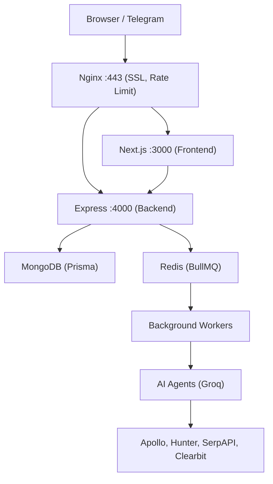
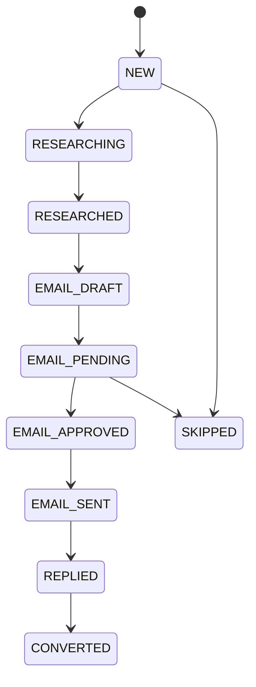
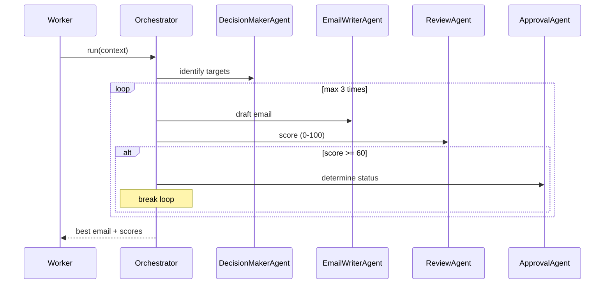
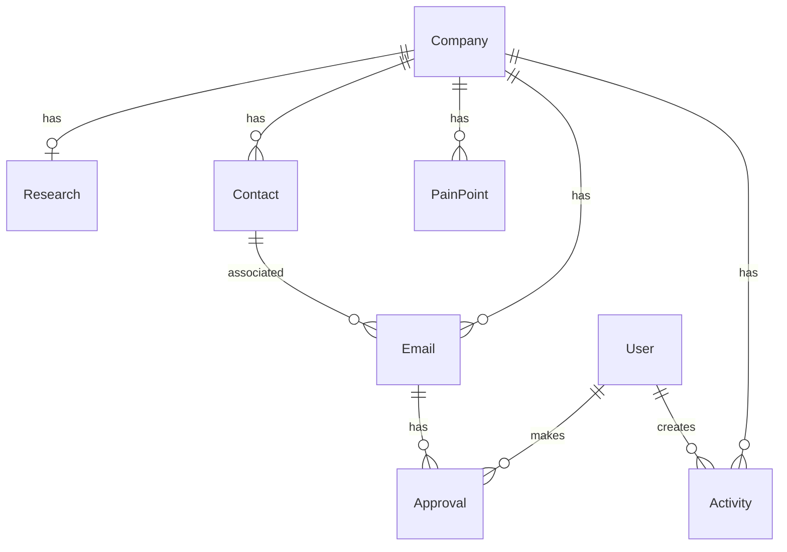

# HERMES — Complete System Documentation

> This is a single-file consolidated reference combining all 22 documentation phases.
> For individual deep-dives, see the `/docs/` directory.

---

## Table of Contents

1. [Project Overview](#1-project-overview)
2. [Repository Analysis](#2-repository-analysis)
3. [System Architecture](#3-system-architecture)
4. [Complete Project Workflow](#4-complete-project-workflow)
5. [End-to-End Feature Flows](#5-end-to-end-feature-flows)
6. [Backend Documentation](#6-backend-documentation)
7. [Frontend Documentation](#7-frontend-documentation)
8. [Database Documentation](#8-database-documentation)
9. [API Reference Summary](#9-api-reference-summary)
10. [Authentication Flow](#10-authentication-flow)
11. [Data Flow](#11-data-flow)
12. [External Integrations](#12-external-integrations)
13. [Configuration](#13-configuration)
14. [Deployment Architecture](#14-deployment-architecture)
15. [Security Audit](#15-security-audit)
16. [Performance Analysis](#16-performance-analysis)
17. [Error Handling](#17-error-handling)
18. [Developer Guide Summary](#18-developer-guide-summary)
19. [Code Quality Review Summary](#19-code-quality-review-summary)
20. [AI Context Summary](#20-ai-context-summary)
21. [Diagrams](#21-diagrams)
22. [Document Index](#22-document-index)

---

## 1. Project Overview

**HERMES** is a production-grade, AI-powered B2B outreach automation platform purpose-built for selling manufacturing ERP software.

**What it does**:
- Discovers manufacturing companies as sales prospects (Google, Apollo.io, AI-powered)
- Researches each company across 8 dimensions using specialized AI agents
- Generates hyper-personalized cold emails via a multi-agent orchestration pipeline with self-critique loop
- Routes emails through a human approval workflow (web dashboard or Telegram bot)
- Dispatches approved emails via SMTP and tracks delivery metrics

**Business value**: Replaces 4–6 hours of manual SDR work per company with a ~10-minute automated pipeline, while maintaining human quality control.

**Primary users**: Sales Manager (ADMIN), Sales Reps (USER), automated system (cron jobs + workers)

**Tech stack**: Node.js 20, TypeScript 5, Next.js 15, Express.js, MongoDB 7 (Prisma), Redis 7 (BullMQ), Groq LLM (llama-3.3-70b), Docker, Nginx, PM2

---

## 2. Repository Analysis

### Monorepo Structure

```
hermes-agent/
├── apps/
│   ├── backend/              # Express API, workers, Telegram bot
│   │   └── src/
│   │       ├── index.ts      # Bootstrap (env, Redis, queues, workers, cron, bot, Express)
│   │       ├── app.ts        # Express setup (middleware, routes)
│   │       ├── config/       # env.ts (Zod), logger.ts (Winston), redis.ts
│   │       ├── middleware/   # authenticate.ts, errorHandler.ts, notFound.ts
│   │       ├── routes/       # 12 route modules
│   │       ├── controllers/  # 12 controllers (1:1 with routes)
│   │       ├── services/     # 13 service files (business logic)
│   │       ├── validators/   # Zod schemas per resource
│   │       ├── integrations/ # Apollo, Hunter, SerpAPI, Clearbit, Nodemailer, OpenAI
│   │       ├── queues/       # BullMQ queue initialization
│   │       ├── jobs/         # 3 workers + cron.ts
│   │       ├── bot/          # telegram.ts (Telegraf)
│   │       └── templates/    # nofoal-waitlist.ts (HTML email)
│   └── frontend/             # Next.js 15 dashboard
│       └── src/
│           ├── app/          # App Router (layout, pages, auth, API)
│           ├── components/   # UI components by feature
│           ├── lib/          # auth.ts (NextAuth), api.ts (Axios), utils.ts
│           └── store/        # Zustand (app.store.ts)
├── packages/
│   ├── agents/               # AI agent library
│   │   └── src/
│   │       ├── base.agent.ts         # Abstract base class
│   │       ├── orchestrator.ts       # HermesOrchestrator (8-agent chain)
│   │       ├── company-research.agent.ts
│   │       ├── pain-point-analysis.agent.ts
│   │       ├── decision-maker.agent.ts
│   │       ├── email-writer.agent.ts
│   │       ├── review.agent.ts
│   │       ├── approval.agent.ts
│   │       ├── prospect-finder.agent.ts
│   │       └── erp-knowledge.agent.ts
│   ├── database/             # Prisma + MongoDB client
│   │   └── prisma/schema.prisma    # 11 models, 5 enums
│   └── shared/               # TypeScript types + utils
│       └── src/types/index.ts
├── scripts/setup-vps.sh      # Ubuntu 24.04 VPS provisioner
├── docker-compose.yml        # 5 services: mongo, redis, backend, frontend, nginx
├── Dockerfile                # Multi-stage production build
├── nginx.conf                # SSL, rate limiting, security headers
└── pm2.config.js             # PM2 cluster (2× backend, 1× frontend)
```

### Package Dependency Graph

```
apps/frontend → packages/shared
apps/backend  → packages/shared, packages/database, packages/agents
packages/agents → packages/shared
packages/database → (Prisma generates from schema)
```

---

## 3. System Architecture

### Overall Architecture

```
Browser/Telegram
      │
   Nginx :443 (SSL, Rate Limiting, Gzip)
      ├── → Next.js :3000 (Frontend)
      └── → Express :4000 (Backend API)
                │
    ┌───────────┼───────────┐
    │           │           │
 MongoDB     Redis       External
 (Prisma)  (BullMQ)     APIs
    │           │
    └───────────┴── Background Workers
                       │
                 AI Agents (Groq LLM)
```

### Layered Backend Architecture

```
HTTP (Nginx) → Express Middleware Stack → Routes → Controllers → Services → DB/Queue/Integrations
```

Each layer has a single responsibility. No layer skips another.

### Agent Architecture

```
HermesOrchestrator
├── CompanyResearchAgent    (research synthesis)
├── PainPointAnalysisAgent  (ERP pain mapping)
├── DecisionMakerAgent      (target identification)
├── EmailWriterAgent        (email drafting)
├── ReviewAgent             (quality scoring 0-100)
├── ApprovalAgent           (approval decision)
├── ProspectFinderAgent     (company discovery)
└── ERPKnowledgeAgent       (domain context)

All extend BaseAgent<TInput, TOutput>
```

---

## 4. Complete Project Workflow

### Startup
1. Zod validates all env vars → crash on invalid
2. Redis connects → MongoDB connects via Prisma
3. BullMQ queues initialized (5 queues)
4. Workers started (3 worker types)
5. Cron jobs registered (4 schedules)
6. Telegram bot webhook registered
7. Express listening on port 4000

### Request Lifecycle
```
Nginx → CORS/Helmet → Rate Limit → Route Match → JWT Auth → Controller → Zod Validate → Service → DB/Queue → Response
```

### Background Job Lifecycle
```
HTTP trigger / Cron → BullMQ Redis queue → Worker picks up → Agent chain runs → DB saved → Status updated → Activity logged
```

### Shutdown
```
SIGTERM → Stop accepting requests → Drain active requests → Stop workers → Close Redis → Close MongoDB → Exit 0
```

---

## 5. End-to-End Feature Flows

### Full Pipeline (Company → Sent Email)

| Step | Status | Trigger | Key Service |
|---|---|---|---|
| Discovery | NEW | Cron/Manual | `discovery.service.ts` |
| Research | RESEARCHING → RESEARCHED | Queue | `research.worker.ts` |
| Email Gen | EMAIL_DRAFT → EMAIL_PENDING | Queue | `email-generation.worker.ts` |
| Approval | EMAIL_PENDING → EMAIL_APPROVED | Human UI/Telegram | `approval.service.ts` |
| Dispatch | EMAIL_APPROVED → EMAIL_SENT | Human UI | `email.service.ts` |
| Reply | EMAIL_SENT → REPLIED | Manual update | `prospect.service.ts` |
| Convert | REPLIED → CONVERTED | Manual update | `prospect.service.ts` |

### HermesOrchestrator Flow
1. `DecisionMakerAgent` → identify best contact titles
2. Loop (max 3): `EmailWriterAgent` → `ReviewAgent` (score ≥ 60 to pass) → `ApprovalAgent`
3. If all attempts fail: use best-scoring version

---

## 6. Backend Documentation

**12 Route Modules**: auth, prospects, companies, contacts, research, emails, approvals, dashboard, settings, telegram, discovery, waitlist

**13 Services**: auth, prospect, company, contact, email, research, discovery, approval, dashboard, activity, settings, waitlist, plus prospect discovery variant

**3 Background Workers**:
- `research.worker.ts` (concurrency: 5) — runs CompanyResearchAgent + PainPointAnalysisAgent
- `email-generation.worker.ts` (concurrency: 3) — runs HermesOrchestrator
- `prospect-discovery.worker.ts` (concurrency: 1) — runs ProspectFinderAgent

**Queue Configuration**: 3 retries, exponential backoff (5s base), keep last 100 completed, 50 failed

**Telegram Bot Commands**: `/start`, `/stats`, `/approve <id>`, `/find <query>`, `/research <id>`

---

## 7. Frontend Documentation

**Framework**: Next.js 15 App Router, React 19, Tailwind CSS

**Route Groups**:
- Public: `/auth/login`
- Protected `(dashboard)`: `/dashboard`, `/prospects`, `/companies`, `/contacts`, `/research`, `/emails`, `/approvals`, `/settings`, `/waitlist`

**Auth**: NextAuth v5 (Credentials) → backend JWT → session cookie (HttpOnly) → Axios interceptor injects Bearer token

**State**: React Query (server data, 30s stale), Zustand (UI state), NextAuth session

**Key Components**: `ApprovalQueue`, `ProspectList`, `EmailList`, `DashboardStats`, `ConversionChart`, `DiscoveryPanel`

---

## 8. Database Documentation

**Database**: MongoDB 7 via Prisma ORM 6

**11 Models**: User, Company, Contact, Research, PainPoint, Email, Approval, Activity, Integration, WaitlistLead, Setting

**Core Relationships**:
- `Company` 1→many `Contact`, `PainPoint`, `Email`, `Activity`
- `Company` 1→1 `Research`
- `Email` 1→many `Approval`
- `User` 1→many `Approval`, `Activity`

**ProspectStatus state machine**: NEW → RESEARCHING → RESEARCHED → EMAIL_DRAFT → EMAIL_PENDING → EMAIL_APPROVED → EMAIL_SENT → REPLIED/CONVERTED/SKIPPED

---

## 9. API Reference Summary

**Base URL**: `http://localhost:4000` (dev) / `https://yourdomain.com/api` (prod)

**Auth**: `Authorization: Bearer <jwt>` on all protected routes

**Response envelope**: `{ success, data, message?, meta? }`

**Key endpoint groups**:
- `/api/auth/*` — register, login, me, refresh
- `/api/prospects/*` — CRUD + trigger research/email
- `/api/emails/*` — list, view, send, regenerate
- `/api/approvals/*` — approve, skip, revise
- `/api/dashboard/*` — stats, activity, conversion
- `/api/discovery/*` — search, import
- `/api/settings/*` — read/write (ADMIN only)
- `/api/waitlist/*` — signup, list, send

See [docs/API_REFERENCE.md](docs/API_REFERENCE.md) for complete endpoint documentation.

---

## 10. Authentication Flow

1. User submits email/password to NextAuth
2. NextAuth calls `POST /api/auth/login` on backend
3. Backend: find user → bcrypt compare → sign JWT (HS256, 7 days)
4. NextAuth stores JWT in encrypted session cookie
5. Frontend: Axios request interceptor injects `Authorization: Bearer <token>`
6. Backend: `authenticate` middleware verifies JWT + checks user.isActive
7. Role check: `authorize('ADMIN')` for protected admin routes

**Password**: bcrypt 12 rounds (~300ms per hash)  
**Rate limit**: 5 auth requests/minute per IP (Nginx)

---

## 11. Data Flow

```
External APIs (Google, Apollo, Hunter, Clearbit)
    ↓ [Discovery]
MongoDB: Company records (status: NEW)
    ↓ [Research workers]
MongoDB: Research + PainPoint records
    ↓ [Email generation workers + Groq LLM]
MongoDB: Email records (status: PENDING_APPROVAL)
    ↓ [Human approval via UI/Telegram]
MongoDB: Approval records (Email.status: APPROVED)
    ↓ [Email dispatch via SMTP]
Prospect's inbox
    ↓ [Reply tracking]
MongoDB: Email.repliedAt / Company.status: REPLIED
    ↓ [Dashboard]
Browser: Charts, KPIs, activity feed
```

---

## 12. External Integrations

| Service | Purpose | Key | Failure Behavior |
|---|---|---|---|
| Groq API | LLM inference (all agents) | `OPENAI_API_KEY` | Retry in BullMQ, return error |
| Apollo.io | Company/person search | `APOLLO_API_KEY` | Return empty results |
| Hunter.io | Email discovery/verification | `HUNTER_API_KEY` | Generate email without verified address |
| SerpAPI | Google search results | `SERPAPI_KEY` | Continue without search data |
| Clearbit | Company enrichment | `CLEARBIT_API_KEY` | Continue without enrichment |
| SMTP | Email delivery | `SMTP_*` vars | Return 500 error |
| Telegram | Bot notifications | `TELEGRAM_BOT_TOKEN` | Bot commands unavailable |

All integrations degrade gracefully — a single API failure does not stop the pipeline.

---

## 13. Configuration

**Validation**: All env vars validated by Zod at startup (`apps/backend/src/config/env.ts`)

**Groups**: App, Database, Redis, Auth, AI, APIs (Apollo/Hunter/Serp/Clearbit), Email, Telegram, Rate Limiting, Queue, Logging, Frontend

**Runtime Config**: `Setting` model in MongoDB for admin-configurable values  
**Build Config**: `tsconfig.base.json` (ES2022, strict, NodeNext modules)  
**Deployment Config**: `pm2.config.js` (cluster mode, memory limits)  
**Proxy Config**: `nginx.conf` (SSL, rate limits, security headers)

---

## 14. Deployment Architecture

**Environments**:
- Dev: `npm run dev` (tsx watch + next dev)
- Docker: `docker compose up -d` (full 5-service stack)
- VPS: PM2 + Nginx + Ubuntu 24.04 (`scripts/setup-vps.sh`)

**Production services**:
- Nginx :80/:443 (SSL, rate limit, gzip, security headers)
- Next.js :3000 (PM2 fork mode, 768MB limit)
- Express :4000 ×2 (PM2 cluster mode, 512MB limit each)
- MongoDB :27017 (not externally exposed)
- Redis :6379 (not externally exposed, 256MB LRU)

**SSL**: Let's Encrypt via Certbot (`certbot --nginx`)  
**Firewall**: UFW (ports 22, 80, 443 only)  
**Container**: Multi-stage Dockerfile, non-root user (hermes:1001)

---

## 15. Security Audit

**Protections in place**:
- TLS 1.2/1.3 only, strong ciphers, HSTS preload
- Nginx rate limiting: 20r/s (API), 5r/min (auth)
- JWT HS256, 32-char min secret, 7-day expiry
- bcrypt 12 rounds (password hashing)
- Session cookie: HttpOnly, Secure, SameSite=Lax
- Helmet security headers (CSP, X-Frame-Options, nosniff, XSS-Filter)
- CORS whitelist (only configured APP_URL)
- Prisma parameterized queries (no NoSQL injection possible)
- Zod input validation on all endpoints
- Non-root Docker user (hermes:1001)
- UFW firewall (DB/Redis not exposed externally)

**Key gaps to address**:
1. No account lockout after failed logins
2. JWT tokens cannot be revoked (no blocklist)
3. Integration API keys stored as plaintext in MongoDB
4. No automated test suite

---

## 16. Performance Analysis

**Async design**: All LLM calls in background workers — HTTP requests never block on AI  
**Queue throughput**: 5 research + 3 email workers = 8 concurrent LLM sessions  
**Caching**: React Query (30s stale), Nginx static cache (1 year), gzip compression  
**DB indexes**: status, industry, country (Company); companyId, email (Contact); sentAt, status (Email)  
**PM2 cluster**: 2 backend instances for multi-core utilization

**Bottlenecks**: Groq free-tier rate limits, no full-text search index, Activity table grows unbounded, no CDN

---

## 17. Error Handling

**Backend**:
- `AppError` class for known errors (extends Error with statusCode)
- `errorHandler.ts` global Express handler formats all errors
- Zod errors → 422 with field-level details
- Unexpected errors → 500 (stack hidden in production)

**Queue jobs**:
- 3 retries with exponential backoff (5s, 10s, 20s)
- Failed jobs retained in Redis for debugging

**Agent failures**:
- `BaseAgent.wrap()` catches all errors → returns `AgentResult { success: false, error }`
- Orchestrator: all 3 attempts fail → return best-scoring version (not crash)

**Frontend**:
- React Query: 3 retries on API errors
- 401 interceptor → auto-redirect to login
- Sonner toasts for user-facing errors

---

## 18. Developer Guide Summary

```bash
# Setup
npm install && cp .env.example .env
npm run db:generate && npm run db:push && npm run db:seed
npm run dev

# Key scripts
npm run build          # Build all packages
npm run type-check     # TypeScript check
npm run lint           # ESLint
npm run db:studio      # Prisma Studio (GUI)
```

**To add a feature**: Route → Controller → Validator → Service → (DB schema if needed)  
**To add an AI agent**: Extend `BaseAgent`, export from `packages/agents/src/index.ts`  
**To add a DB model**: Edit `schema.prisma` → `npm run db:generate` → `npm run db:push`

**Conventions**: TypeScript strict, ESM (.js imports), kebab-case files, PascalCase classes, camelCase vars

---

## 19. Code Quality Review Summary

**Critical** (2): No test suite, API keys not encrypted at rest  
**High** (5): No account lockout, no JWT revocation, missing pagination, no full-text index, orchestrator silently accepts low-quality emails  
**Medium** (7): No soft delete, hardcoded retry counts, missing Express type augmentation, WaitlistLead unique constraint issue, rawData retention, missing activity pagination  
**Low** (5): Large app.ts, Telegram shutdown, SMTP_PORT coercion, no frontend error tracking

**Strengths**: Agent abstraction, Zod env validation, queue-based async, Prisma type safety, layered architecture, multi-stage Docker, production Nginx config

---

## 20. AI Context Summary

**Core invariants**:
1. Never LLM in HTTP handlers — use queues
2. Agents are stateless — each `run()` is independent
3. Company state machine enforced by `prospect.service.ts` only
4. All DB access via Prisma (no raw queries)
5. All secrets from `process.env` (validated by Zod env.ts)
6. Services throw `AppError`, controllers use `next(error)`

**Business rules**:
1. All emails need human approval before sending
2. Research must exist before email generation
3. Primary pain point (`isPrimary: true`) drives email personalization
4. Email versions are tracked (never deleted)
5. Activity records are append-only (never updated/deleted)

---

## 21. Diagrams

### Overall Architecture



### ProspectStatus State Machine



### HermesOrchestrator Sequence



### Database ER Diagram



---

## 22. Document Index

| File | Purpose |
|---|---|
| [docs/PROJECT_OVERVIEW.md](docs/PROJECT_OVERVIEW.md) | What HERMES is, business purpose, architecture |
| [docs/ARCHITECTURE.md](docs/ARCHITECTURE.md) | Layered architecture, module diagram, communication patterns |
| [docs/SYSTEM_DESIGN.md](docs/SYSTEM_DESIGN.md) | Design decisions, state machine, agent patterns |
| [docs/BACKEND.md](docs/BACKEND.md) | All routes, controllers, services, workers, queues |
| [docs/FRONTEND.md](docs/FRONTEND.md) | Pages, components, routing, auth, state management |
| [docs/DATABASE.md](docs/DATABASE.md) | Full schema, ER diagram, data lifecycle |
| [docs/API_REFERENCE.md](docs/API_REFERENCE.md) | Every endpoint with examples |
| [docs/AUTHENTICATION.md](docs/AUTHENTICATION.md) | JWT, NextAuth, RBAC, security model |
| [docs/WORKFLOW.md](docs/WORKFLOW.md) | End-to-end pipeline with sequence diagrams |
| [docs/DEPLOYMENT.md](docs/DEPLOYMENT.md) | Docker, VPS, PM2, Nginx configuration |
| [docs/SECURITY.md](docs/SECURITY.md) | Security audit, OWASP assessment, recommendations |
| [docs/PERFORMANCE.md](docs/PERFORMANCE.md) | Caching, bottlenecks, scalability |
| [docs/DEVELOPER_GUIDE.md](docs/DEVELOPER_GUIDE.md) | Setup, add features, debugging, conventions |
| [docs/CODE_REVIEW.md](docs/CODE_REVIEW.md) | Code quality findings, technical debt |
| [docs/AI_CONTEXT.md](docs/AI_CONTEXT.md) | AI assistant reference document |
| [docs/README_GENERATED.md](docs/README_GENERATED.md) | Project README |
| [SYSTEM_FLOW.md](SYSTEM_FLOW.md) | System flow diagrams |
| [PROJECT_FLOW.md](PROJECT_FLOW.md) | Feature-by-feature flow diagrams |
| [COMPLETE_SYSTEM_DOCUMENTATION.md](COMPLETE_SYSTEM_DOCUMENTATION.md) | This file |

---

*Generated by comprehensive codebase analysis. All statements are based on actual source code. Inferences are labeled where present.*
