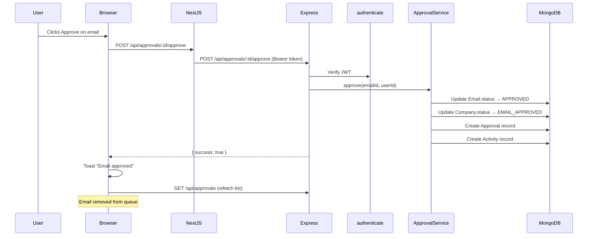
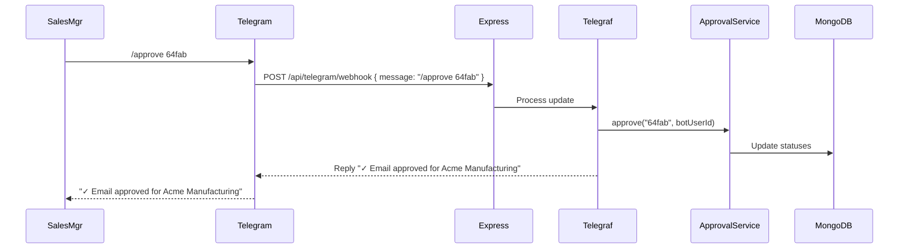

# HERMES — Project Flow

## End-to-End Feature Flow: Prospect → Sent Email

### Step 1: Company Discovered

**Trigger**: Daily cron (2am) or user submits discovery form

**User Action**: Admin navigates to Dashboard → clicks "Discover Prospects" → enters: Industry=Manufacturing, Country=USA, Keywords=["ERP", "inventory"]

**API Endpoint**: `POST /api/discovery/search`

**Controller**: `discovery.controller.ts` → `discoveryService.search()`

**Validation**: Zod validates industry/country/keywords fields

**Service**: `discovery.service.ts`
1. Calls `SerpAPI` for Google search results
2. Passes results to `ProspectFinderAgent`
3. Agent calls Groq LLM, returns structured company candidates
4. Filters candidates against existing MongoDB companies

**Database**: `prisma.company.createMany()` inserts new companies with `status: NEW`

**External Services**: SerpAPI (Google), Apollo.io (optional enrichment), Groq LLM

**Response**: `{ imported: 12, skipped: 3 }`

**UI Update**: Frontend shows success toast; prospect list refreshes via React Query invalidation

---

### Step 2: Company Researched

**Trigger**: User clicks "Research" on a company OR research cron runs (every 2h)

**User Action**: User is on `/prospects`, sees Acme Manufacturing (status: NEW), clicks Research button

**API Endpoint**: `POST /api/prospects/64f8a.../research`

**Controller**: `prospect.controller.ts` → `prospectService.triggerResearch(id)`

**Service**: `prospect.service.ts`
1. Updates `Company.status` → `RESEARCHING`
2. Adds job `{ companyId }` to `research` BullMQ queue
3. Returns `{ jobId }` immediately

**Response**: `{ success: true, data: { jobId: "job_abc" } }` (HTTP response — job runs async)

**Background Worker** (`research.worker.ts`):
1. Loads company from MongoDB
2. Calls SerpAPI for news + product info
3. Calls Clearbit for employee count, tech stack, logo
4. Runs `CompanyResearchAgent` (Groq LLM) → structured ResearchData
5. Runs `PainPointAnalysisAgent` (Groq LLM) → array of PainPoint objects
6. Saves `Research` record to MongoDB
7. Saves `PainPoint` records (sets `isPrimary: true` on top pain point)
8. Updates `Company.status` → `RESEARCHED`
9. Creates `Activity` record: `type: RESEARCH_COMPLETED`

**UI Update**: Next time user loads `/prospects`, status badge shows "RESEARCHED"

---

### Step 3: Email Generated

**Trigger**: User clicks "Generate Email" on a RESEARCHED company OR email cron runs (every 4h)

**User Action**: User clicks "Generate Email" on Acme Manufacturing

**API Endpoint**: `POST /api/prospects/64f8a.../email`

**Controller**: `prospect.controller.ts` → `prospectService.triggerEmailGeneration(id)`

**Service**:
1. Updates `Company.status` → `EMAIL_DRAFT`
2. Adds job to `email-generation` queue
3. Returns `{ jobId }` immediately

**Background Worker** (`email-generation.worker.ts`):
1. Loads company + research + pain points from MongoDB
2. Calls Hunter.io to find/verify decision-maker email
3. Calls `HermesOrchestrator` with full context

**HermesOrchestrator**:
1. `DecisionMakerAgent` → identifies target roles (e.g., "VP Operations", "Manufacturing Director")
2. **Loop** (max 3 attempts):
   - `EmailWriterAgent` → drafts personalized cold email
   - `ReviewAgent` → scores across 6 dimensions (0–100)
   - If overall ≥ 60: `ApprovalAgent` → returns status (typically PENDING_REVIEW)
   - If overall < 60: stores draft as version, passes revision notes to next iteration
3. Returns best email with scores

**Worker** (after orchestrator):
1. Saves `Email` record with `status: PENDING_APPROVAL`, review scores, version
2. Updates `Company.status` → `EMAIL_PENDING`
3. Creates Activity record

---

### Step 4: Email Reviewed by Human

**User Action**: User navigates to `/approvals`, sees Acme Manufacturing email

**Component**: `ApprovalQueue.tsx` loads via `GET /api/approvals`

**User sees**:
- Email subject: "Reducing Acme's Inventory Shortages by 40%"
- Email body (personalized with specific pain points)
- Review scores: Personalization 92, Business Value 88, Overall 87

**User Decision**: Clicks "Approve"

**API Endpoint**: `POST /api/approvals/64fab.../approve`

**Controller**: `approval.controller.ts` → `approvalService.approve(emailId, userId)`

**Service**:
1. Updates `Email.status` → `APPROVED`
2. Updates `Company.status` → `EMAIL_APPROVED`
3. Creates `Approval` record (action: APPROVED, userId)
4. Creates `Activity` record

**Response**: `{ success: true, message: "Email approved" }`

**Sequence Diagram**:

---

### Step 5: Email Dispatched

**User Action**: User clicks "Send" on approved email in `/emails` list

**API Endpoint**: `POST /api/emails/64fab.../send`

**Controller**: `email.controller.ts` → `emailService.send(emailId)`

**Service** (`email.service.ts`):
1. Loads Email record (validates status = APPROVED)
2. Loads Contact record (gets verified email address)
3. Creates Nodemailer transport from `SMTP_*` env vars
4. Sends email:
   - `From`: `SMTP_FROM`
   - `To`: `contact.email`
   - `Subject`: `email.subject`
   - `html`: `email.body`
5. On success:
   - `Email.status` → `SENT`
   - `Email.sentAt` = current timestamp
   - `Email.messageId` = SMTP message ID
   - `Company.status` → `EMAIL_SENT`
   - Creates `Activity` (type: `EMAIL_SENT`)

**Response**: `{ success: true, message: "Email sent", data: { messageId: "<abc@smtp.gmail.com>" } }`

---

## Alternative Flow: Telegram Approval

---

## Rejection Flow: Email Revision

**User Action**: User clicks "Revise" and types "Too generic. Mention their Boeing contract win from last month."

**API Endpoint**: `POST /api/approvals/64fab.../revise`

**Request body**: `{ "instructions": "Mention their Boeing contract win from last month" }`

**Service**:
1. Creates `Approval` record (action: REVISED, instructions saved)
2. Sets `Email.status` → `DRAFT`
3. Queues new email generation job WITH instructions in payload
4. Worker reruns orchestrator, EmailWriterAgent receives previous versions + instructions as context
5. New email version saved with incremented `Email.version`
6. `Email.status` → `PENDING_APPROVAL`

User sees the revised email in the approval queue for a second review.

---

## Feature: Waitlist Signup (Secondary Flow)

1. External e-commerce site POSTs to `POST /api/waitlist` with `{ email, name, source }` + `X-API-Key` header
2. `WaitlistLead` created with `status: PENDING`
3. Admin logs in to dashboard, navigates to `/waitlist`
4. Views PENDING leads, clicks "Send Emails"
5. `POST /api/waitlist/send` triggers batch email via Nodemailer
6. `nofoal-waitlist.ts` template rendered per lead
7. Each lead: `status: SENT`, `emailSentAt` updated
8. Response: `{ sent: 45, failed: 2 }`
