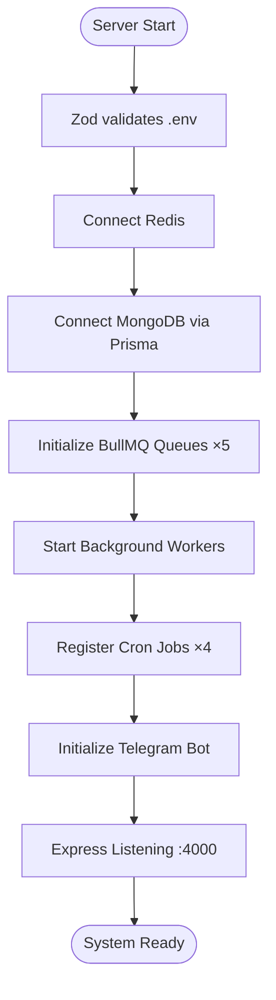
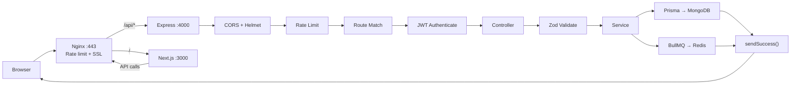
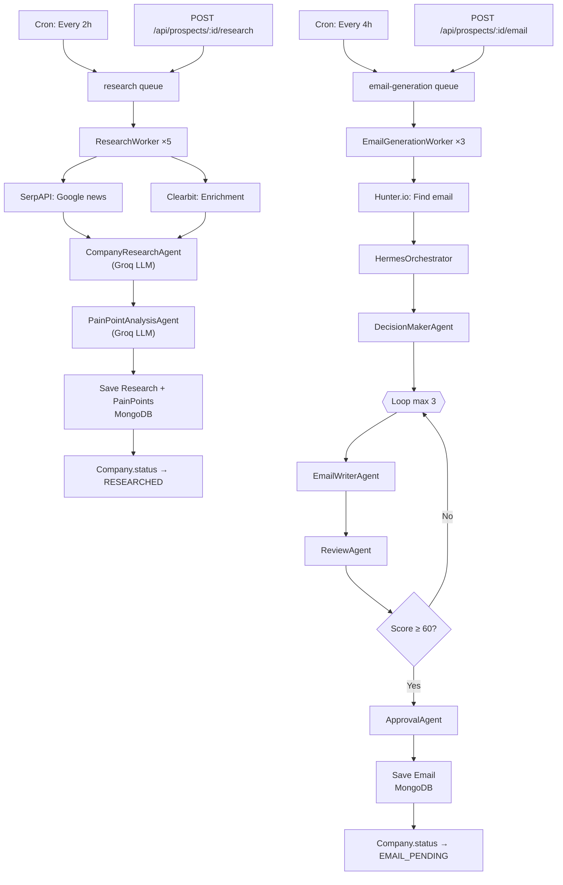
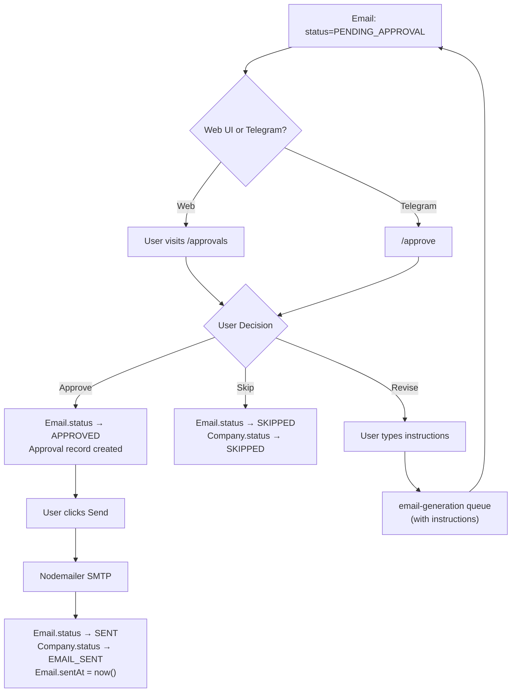
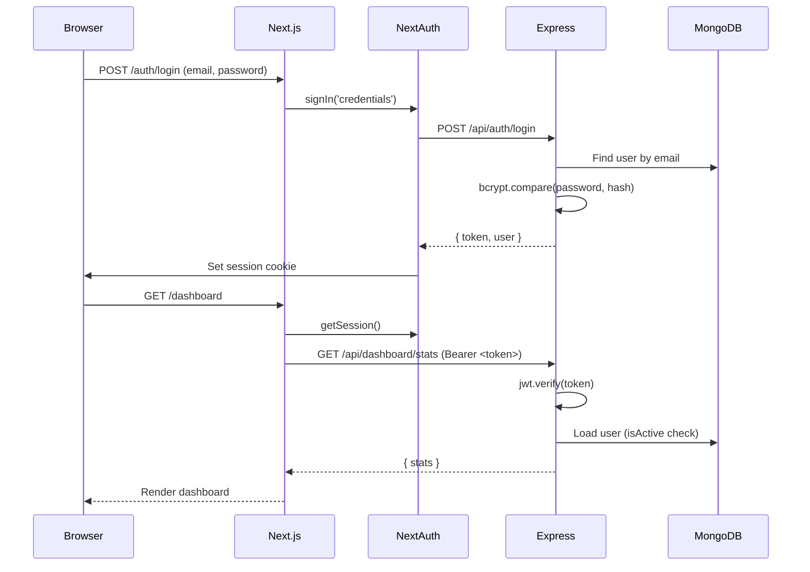
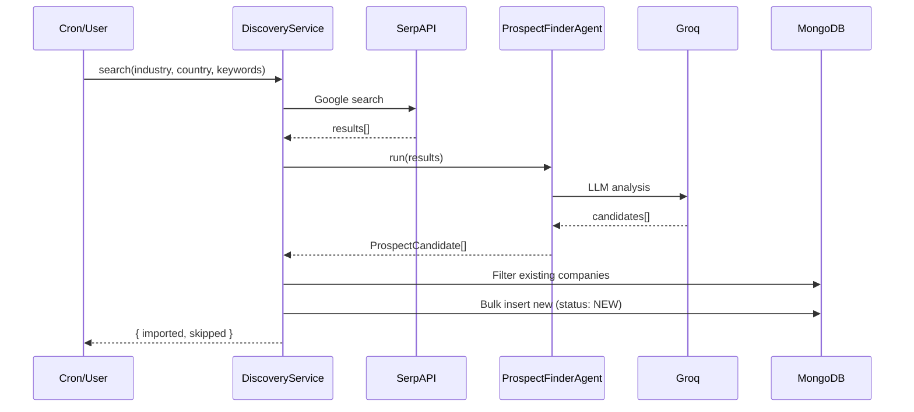
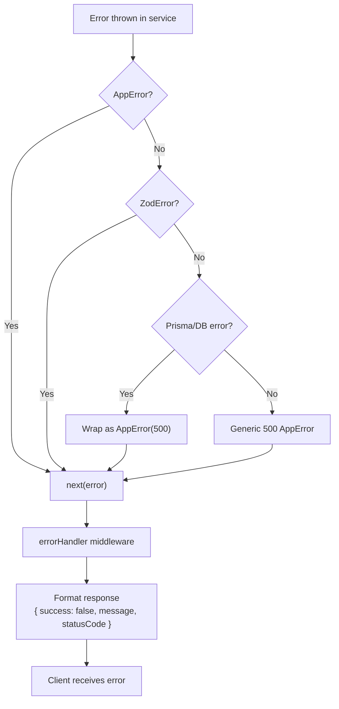

# HERMES — System Flow

## Complete System Flow from Startup to Email Delivery

---

## Request Flow

---

## Background Processing Flow

---

## Human Approval Flow

---

## Authentication Flow

---

## Discovery Flow

---

## Error Handling Flow

