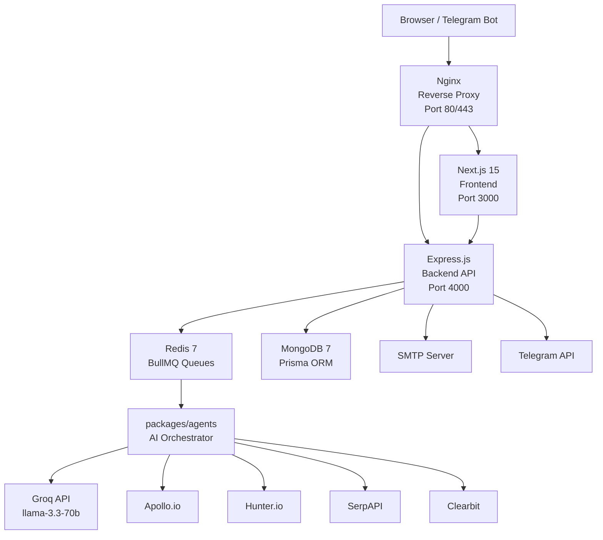
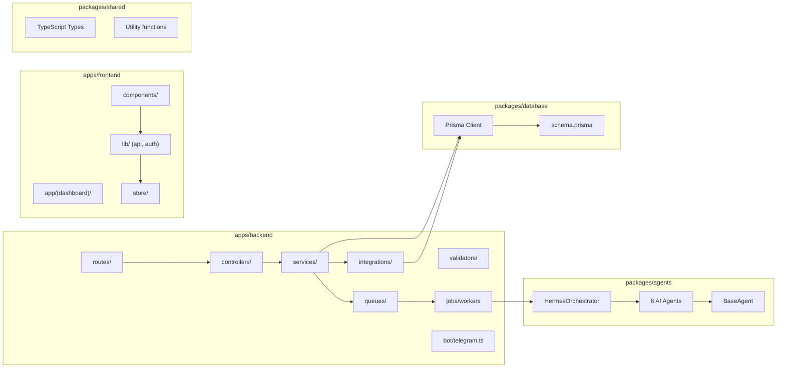
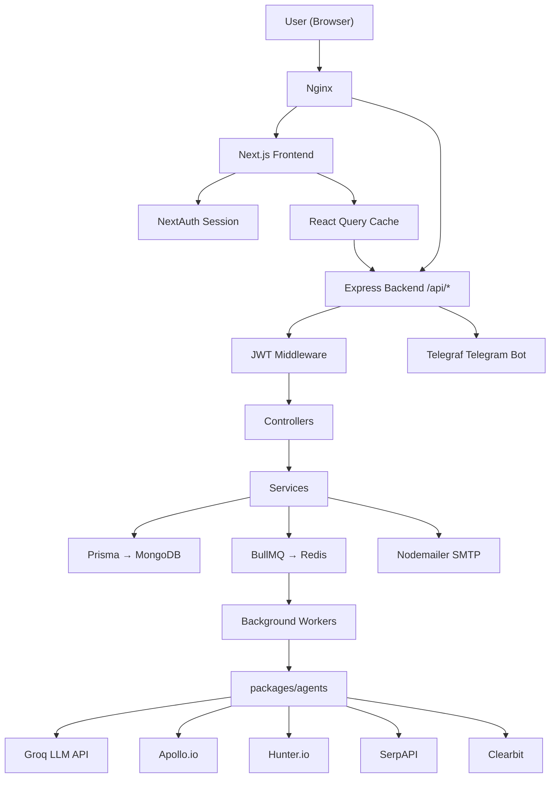
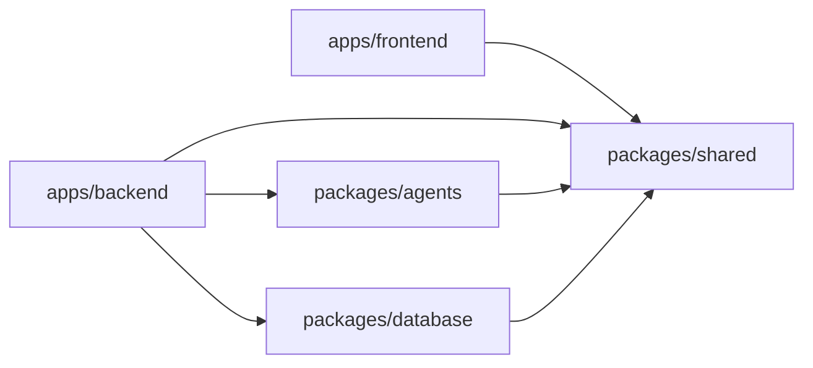

# HERMES — Architecture Document

## Overall Architecture

HERMES follows a **layered monorepo architecture** composed of two deployable applications (`backend`, `frontend`) and three shared packages (`agents`, `database`, `shared`). A Nginx reverse proxy sits in front of both applications.



---

## Layered Architecture

### Backend Layers (apps/backend/src)

```
┌─────────────────────────────────────┐
│         HTTP Layer (Express)         │
│  Route registration · Middleware     │
│  Rate limiting · CORS · Helmet       │
└─────────────────────┬───────────────┘
                      │
┌─────────────────────▼───────────────┐
│         Controller Layer             │
│  Request parsing · Input validation  │
│  Response shaping · Error forwarding │
└─────────────────────┬───────────────┘
                      │
┌─────────────────────▼───────────────┐
│          Service Layer               │
│  Business rules · Orchestration      │
│  Queue dispatch · Activity logging   │
└─────────────────────┬───────────────┘
                      │
       ┌──────────────┴──────────────┐
       │                             │
┌──────▼─────────┐          ┌────────▼────────┐
│ Integration     │          │  Database Layer  │
│ Layer           │          │  Prisma + Mongo  │
│ OpenAI/Groq    │          │                  │
│ Apollo/Hunter  │          └─────────────────┘
│ Clearbit/Serp  │
└────────────────┘
```

### Frontend Layers (apps/frontend/src)

```
┌─────────────────────────────────────┐
│       Next.js App Router             │
│  Server Components · Route Groups   │
│  Layouts · Middleware                │
└─────────────────────┬───────────────┘
                      │
┌─────────────────────▼───────────────┐
│         Component Layer              │
│  Page components · UI components    │
│  Forms · Charts                     │
└─────────────────────┬───────────────┘
                      │
┌─────────────────────▼───────────────┐
│         Data Layer                   │
│  React Query · Zustand store        │
│  Axios API client (lib/api.ts)      │
└─────────────────────┬───────────────┘
                      │
┌─────────────────────▼───────────────┐
│         Auth Layer                   │
│  NextAuth v5 · Session management   │
│  JWT token injection (interceptor)  │
└─────────────────────────────────────┘
```

---

## Module Architecture



---

## Service Architecture

| Service | Technology | Role |
|---|---|---|
| `auth.service.ts` | bcryptjs + jsonwebtoken | User registration, login, JWT issuance |
| `prospect.service.ts` | Prisma + BullMQ | Prospect CRUD, research/email queue dispatch |
| `company.service.ts` | Prisma | Company data management |
| `contact.service.ts` | Prisma | Contact management |
| `research.service.ts` | Prisma + BullMQ | Research results CRUD, queue trigger |
| `email.service.ts` | Prisma + Nodemailer + BullMQ | Email generation orchestration, SMTP dispatch |
| `discovery.service.ts` | SerpAPI + Apollo + AI | Company discovery from web search |
| `approval.service.ts` | Prisma | Email approval workflow |
| `dashboard.service.ts` | Prisma | Aggregate statistics |
| `activity.service.ts` | Prisma | Audit log writes |
| `settings.service.ts` | Prisma | Key-value app settings |
| `waitlist.service.ts` | Prisma + Nodemailer | Waitlist capture and email sending |

---

## Component Relationships



---

## Runtime Flow

### HTTP Request Lifecycle

```
1. Request arrives at Nginx
   ├── Rate limit check (20 req/s API, 5 req/min auth)
   ├── SSL termination
   └── Proxy pass to Express :4000

2. Express middleware stack
   ├── cors() — whitelist check
   ├── helmet() — security headers
   ├── compression() — gzip
   ├── express.json() — body parsing
   ├── morgan() — request logging
   └── express-rate-limit — app-level rate limit

3. Route matching → Controller invoked

4. authenticate() middleware
   ├── Extract Bearer token from Authorization header
   ├── jwt.verify() with JWT_SECRET
   ├── Load user from MongoDB via Prisma
   └── Attach req.user

5. Controller
   ├── Parse req.body / req.params / req.query
   ├── Zod schema validation
   └── Call service method

6. Service
   ├── Business logic execution
   ├── Prisma ORM calls (MongoDB)
   ├── Queue job dispatch (if async work needed)
   └── activityService.logActivity()

7. Controller → sendSuccess() / sendCreated()
   └── { success: true, data: {...}, message: "..." }

8. Error path:
   ├── AppError thrown by service
   ├── Forwarded via next(error)
   └── errorHandler.ts → shaped error response
```

### Background Job Lifecycle

```
1. Service calls queue.add('job-name', payload, options)
   └── BullMQ stores job in Redis

2. Worker picks up job
   ├── research.worker.ts  (concurrency: 5)
   └── email-generation.worker.ts  (concurrency: 3)

3. Worker executes HermesOrchestrator or standalone agent

4. Result saved to MongoDB via Prisma

5. Company/Email status updated

6. Activity logged
```

---

## Dependency Graph



All packages depend on `packages/shared` for type definitions. Only the backend depends on `packages/database` (Prisma client). The agents package is imported by backend workers.

---

## Communication Patterns

| Pattern | Used For |
|---|---|
| HTTP REST | Frontend ↔ Backend API |
| BullMQ jobs | Backend → Worker (async research/email) |
| Telegram webhooks | Telegram API → Backend `/api/telegram/webhook` |
| Direct function calls | Backend services → packages/agents (in-process, no network) |
| Prisma queries | Backend/workers → MongoDB |
| Redis commands | BullMQ queue state management |
| SMTP | Backend → Email server |
| HTTP (axios) | Integrations → Apollo, Hunter, SerpAPI, Clearbit, Groq |

---

## Cron Schedules

| Job | Schedule | Purpose |
|---|---|---|
| Prospect Discovery | Daily | Auto-discover new companies from Google/Apollo |
| Company Research | Every 2 hours | Research queued NEW companies |
| Email Generation | Every 4 hours | Generate emails for RESEARCHED companies |
| Stats Sync | Daily | Aggregate dashboard statistics |

---

## Port Allocation

| Service | Port |
|---|---|
| Nginx | 80, 443 |
| Next.js Frontend | 3000 |
| Express Backend | 4000 |
| MongoDB | 27017 |
| Redis | 6379 |
