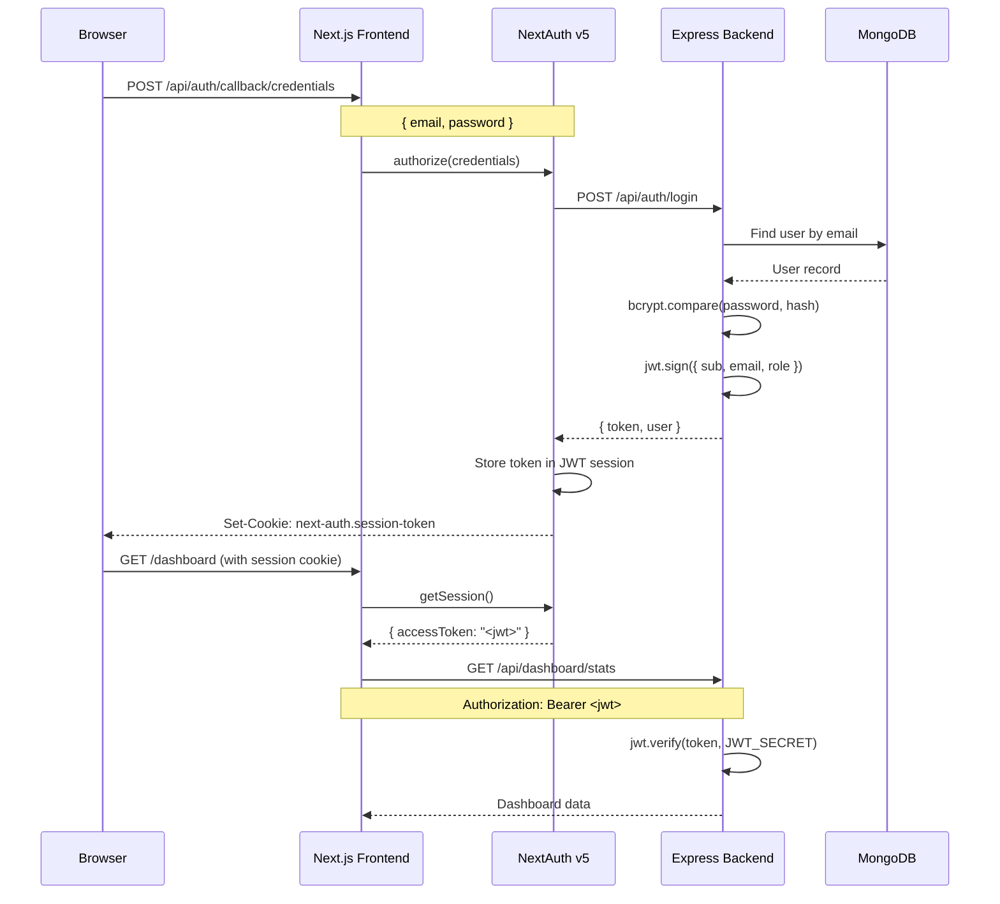
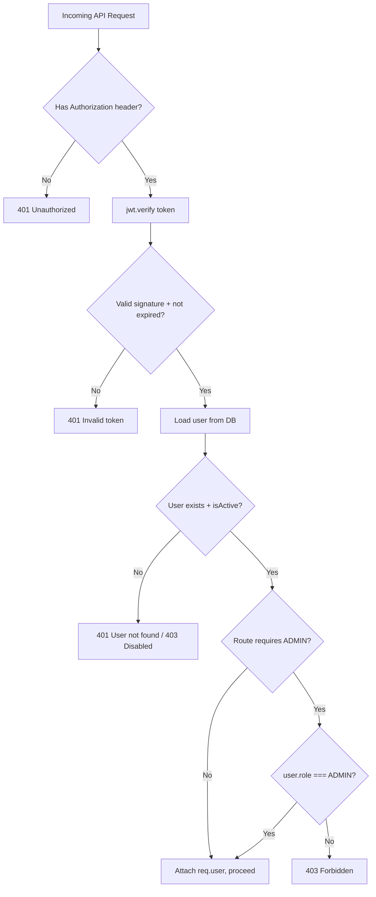

# HERMES — Authentication & Authorization

## Overview

HERMES uses a **two-tier authentication system**:
1. **Backend**: JWT (JSON Web Tokens) signed with HMAC-SHA256
2. **Frontend**: NextAuth v5 (Credentials provider) wrapping the backend JWT

There is no OAuth/social login. All users are internal (sales team) and authenticate with email + password.

---

## Authentication Architecture



---

## Backend Authentication

### JWT Configuration

```typescript
// config/env.ts (Zod validated)
JWT_SECRET: z.string().min(32)   // Minimum 32 characters enforced
JWT_EXPIRES_IN: z.string()       // Default: '7d'
```

### Token Structure

JWT payload:
```json
{
  "sub": "64f8a1b2c3d4e5f6a7b8c9d0",
  "email": "jane@company.com",
  "role": "USER",
  "iat": 1720000000,
  "exp": 1720604800
}
```

Signed with `HS256` algorithm using `JWT_SECRET`.

### Token Issuance (`auth.service.ts`)

```typescript
const token = jwt.sign(
  { sub: user.id, email: user.email, role: user.role },
  env.JWT_SECRET,
  { expiresIn: env.JWT_EXPIRES_IN }
)
```

### Token Verification (`middleware/authenticate.ts`)

```typescript
authenticate = async (req, res, next) => {
  const authHeader = req.headers.authorization
  if (!authHeader?.startsWith('Bearer ')) throw new AppError('No token', 401)

  const token = authHeader.split(' ')[1]
  const payload = jwt.verify(token, env.JWT_SECRET) as JwtPayload

  const user = await prisma.user.findUnique({ where: { id: payload.sub } })
  if (!user) throw new AppError('User not found', 401)
  if (!user.isActive) throw new AppError('Account disabled', 403)

  req.user = user
  next()
}
```

**Security notes**:
- Token is verified cryptographically on every request (no session store lookup except user active check)
- Expired tokens are rejected by `jwt.verify()` automatically
- Disabled users (`isActive: false`) are rejected even with valid tokens

---

## Frontend Authentication

### NextAuth v5 Configuration (`lib/auth.ts`)

```typescript
export const { handlers, auth, signIn, signOut } = NextAuth({
  providers: [
    Credentials({
      name: 'credentials',
      credentials: {
        email: { label: 'Email', type: 'email' },
        password: { label: 'Password', type: 'password' }
      },
      authorize: async (credentials) => {
        const res = await fetch(`${process.env.NEXTAUTH_URL}/api/auth/login`, {
          method: 'POST',
          headers: { 'Content-Type': 'application/json' },
          body: JSON.stringify(credentials)
        })
        const data = await res.json()
        if (data.success) {
          return { ...data.data.user, accessToken: data.data.token }
        }
        return null
      }
    })
  ],
  callbacks: {
    jwt: ({ token, user }) => {
      if (user) token.accessToken = (user as any).accessToken
      return token
    },
    session: ({ session, token }) => {
      (session as any).accessToken = token.accessToken
      return session
    }
  },
  pages: {
    signIn: '/auth/login'
  }
})
```

### Session Cookie

NextAuth stores the session in a cookie named `next-auth.session-token`. This is an encrypted JWT cookie set with:
- `HttpOnly: true`
- `Secure: true` (in production)
- `SameSite: Lax`
- Expiry: 30 days (NextAuth default)

### Route Protection Middleware

`app/middleware.ts`:
```typescript
export { auth as middleware } from '@/lib/auth'

// Applied to all routes except:
// - /api/* (API routes — handled by their own auth)
// - /_next/static/* (static assets)
// - /auth/* (login page)
// - /favicon.ico
export const config = {
  matcher: ['/((?!api|_next/static|_next/image|favicon.ico|auth).*)']
}
```

Unauthenticated requests to protected routes are redirected to `/auth/login`.

---

## Authorization (Role-Based Access Control)

### Roles

| Role | Description |
|---|---|
| `ADMIN` | Full system access. Can delete records, manage settings, access all users |
| `USER` | Standard sales rep. Can create/read/update prospects, view dashboard, approve emails |

### Backend Role Enforcement

```typescript
// middleware/authenticate.ts
export const authorize = (role: UserRole) => (req: Request, res: Response, next: NextFunction) => {
  if (!req.user) throw new AppError('Unauthorized', 401)
  if (req.user.role !== role) throw new AppError('Forbidden — insufficient permissions', 403)
  next()
}

// Route usage
router.delete('/:id', authenticate, authorize('ADMIN'), controller.delete)
router.get('/settings', authenticate, authorize('ADMIN'), controller.getSettings)
```

### ADMIN-Only Routes

| Endpoint | Reason |
|---|---|
| `DELETE /api/prospects/:id` | Destructive — removes all related data |
| `DELETE /api/companies/:id` | Destructive |
| `DELETE /api/emails/:id` | Destructive |
| `GET /api/settings` | Contains API secrets |
| `PUT /api/settings` | Can change system behavior |
| `GET /api/waitlist` | Internal business data |
| `POST /api/waitlist/send` | Sends bulk emails |

---

## Password Security

### Hashing

```typescript
// auth.service.ts
const SALT_ROUNDS = 12
const passwordHash = await bcrypt.hash(password, SALT_ROUNDS)
```

12 bcrypt rounds provides ~300ms hash time — slow enough to resist brute force, fast enough for user experience.

### Verification

```typescript
const isValid = await bcrypt.compare(plainPassword, user.passwordHash)
```

### Password Requirements (Zod validation)

```typescript
z.string()
  .min(8, 'Minimum 8 characters')
  .regex(/[A-Z]/, 'Must contain uppercase letter')
  .regex(/[0-9]/, 'Must contain a number')
```

---

## Session Management

**Token lifetime**: 7 days (`JWT_EXPIRES_IN=7d`)

**Logout**: Calling `signOut()` (NextAuth) clears the session cookie client-side. Backend tokens are not server-side invalidated (stateless JWT). To force logout all sessions, rotate `JWT_SECRET`.

**Token refresh**: `POST /api/auth/refresh` reissues a fresh token with a new expiry. Called by frontend when `exp` is within 1 hour of expiry.

---

## Security Model

### What's Protected

- All `/api/*` routes except `/api/auth/login`, `/api/auth/register`, `/api/waitlist` (POST only), `/health`
- All dashboard routes via Next.js middleware

### Defense in Depth

| Layer | Protection |
|---|---|
| Nginx | TLS 1.2/1.3 only, strict ciphers, HSTS |
| Express | Helmet (security headers), CORS whitelist |
| Middleware | JWT signature verification on every request |
| Service layer | Role check before sensitive operations |
| Database | No direct exposure — accessed only through Prisma |

### Brute Force Protection

- Nginx: Auth endpoint rate-limited to **5 requests/minute**
- Express: Global rate limiter (`express-rate-limit`)
- bcrypt: 12-round hash makes each guess ~300ms

---

## Telegram Bot Authentication

The Telegram bot webhook (`POST /api/telegram/webhook`) validates requests using Telegraf's built-in webhook secret verification. Only requests from Telegram's servers with the correct webhook secret are processed.

---

## Waitlist API Authentication

The `POST /api/waitlist` endpoint uses an API key (`WAITLIST_API_KEY`) passed in the `X-API-Key` header. This allows external e-commerce platforms to submit waitlist entries without a user JWT.

---

## Flow Diagrams

### Login Flow

```mermaid
flowchart TD
    A[User enters email + password] --> B[LoginForm submits]
    B --> C[NextAuth signIn]
    C --> D[authorize() called]
    D --> E{Backend /api/auth/login}
    E --> F{Email exists?}
    F -- No --> G[Return null → Error toast]
    F -- Yes --> H{Password matches?}
    H -- No --> G
    H -- Yes --> I{Account active?}
    I -- No --> J[Return 403 error]
    I -- Yes --> K[Generate JWT]
    K --> L[Return token + user]
    L --> M[NextAuth stores in session]
    M --> N[Redirect to /dashboard]
```

### Request Authorization Flow


