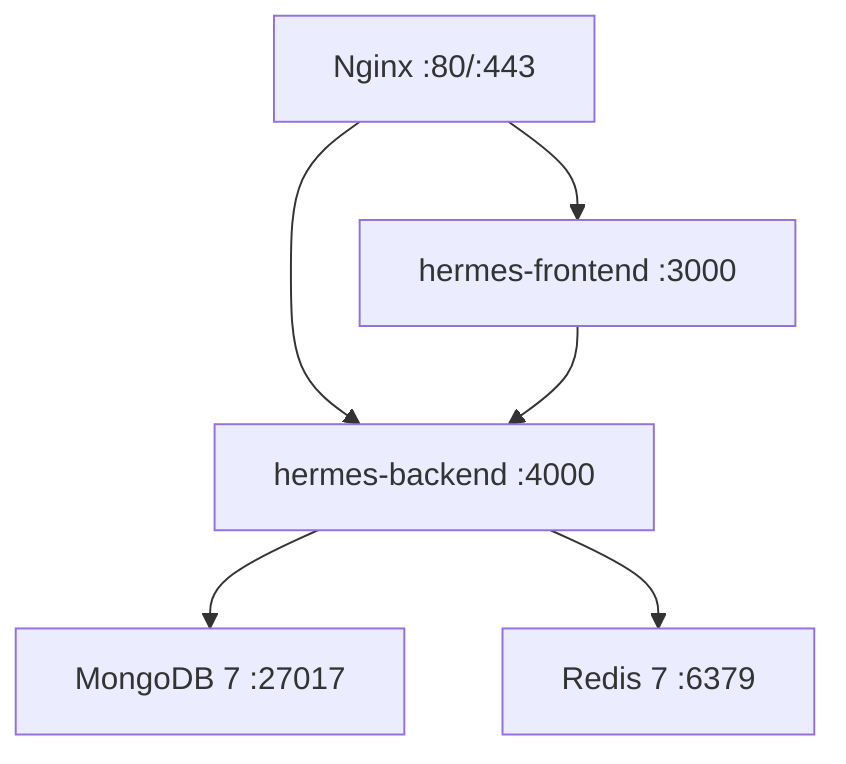
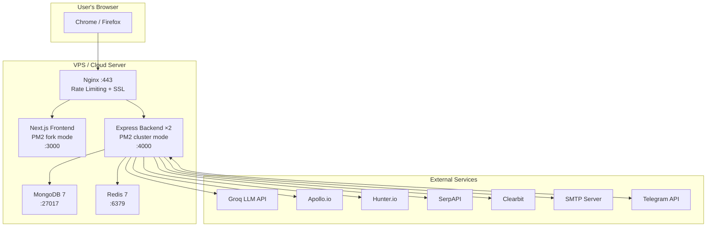

# HERMES — Deployment Documentation

## Deployment Targets

| Environment | Description | Stack |
|---|---|---|
| **Local Development** | Developer machine | npm workspaces + tsx watch |
| **Docker Compose** | Full local stack | Docker Compose (all 5 services) |
| **VPS Production** | Ubuntu 24.04 server | PM2 + Nginx + system MongoDB/Redis |
| **Docker Production** | Container-based | Docker Compose with production Dockerfile |

---

## Local Development Setup

### Prerequisites
- Node.js >= 20.0.0
- npm >= 10.0.0
- MongoDB (local or Atlas)
- Redis (local or Upstash)

### Steps

```bash
# 1. Clone repository
git clone <repo-url>
cd hermes-agent

# 2. Install all dependencies (workspaces)
npm install

# 3. Configure environment
cp .env.example .env
# Edit .env with your keys

# 4. Generate Prisma client
npm run db:generate

# 5. Push schema to MongoDB
npm run db:push

# 6. Seed initial data
npm run db:seed

# 7. Start all services concurrently
npm run dev
```

This runs:
- Backend: `tsx watch apps/backend/src/index.ts` (port 4000)
- Frontend: `next dev` (port 3000)

---

## Docker Compose Deployment

### Architecture



### docker-compose.yml Services

```yaml
services:
  mongodb:
    image: mongo:7
    ports: ["27017:27017"]
    environment:
      MONGO_INITDB_ROOT_USERNAME: hermes
      MONGO_INITDB_ROOT_PASSWORD: ${MONGO_PASSWORD}
    volumes: [mongo_data:/data/db]
    healthcheck:
      test: mongosh --eval "db.adminCommand('ping')"
      interval: 10s
      retries: 5

  redis:
    image: redis:7-alpine
    ports: ["6379:6379"]
    command: redis-server --maxmemory 256mb --maxmemory-policy allkeys-lru
    volumes: [redis_data:/data]

  backend:
    build: .
    target: runner
    ports: ["4000:4000"]
    env_file: .env
    depends_on:
      mongodb: { condition: service_healthy }
      redis: { condition: service_started }

  frontend:
    build: .
    target: runner
    ports: ["3000:3000"]
    env_file: .env
    depends_on: [backend]

  nginx:
    image: nginx:alpine
    ports: ["80:80", "443:443"]
    volumes:
      - ./nginx.conf:/etc/nginx/nginx.conf:ro
      - ./ssl:/etc/nginx/ssl:ro
    depends_on: [frontend, backend]
```

### Run with Docker Compose

```bash
# Build and start all services
docker compose up -d

# View logs
docker compose logs -f backend
docker compose logs -f frontend

# Run DB migrations
docker compose exec backend npm run db:push

# Stop all
docker compose down

# Stop and remove volumes (destructive)
docker compose down -v
```

---

## Dockerfile (Multi-Stage Build)

```dockerfile
# Stage 1: Install dependencies
FROM node:20-alpine AS deps
WORKDIR /app
COPY package*.json ./
COPY apps/*/package*.json apps/
COPY packages/*/package*.json packages/
RUN npm ci --frozen-lockfile

# Stage 2: Build
FROM node:20-alpine AS builder
WORKDIR /app
COPY --from=deps /app/node_modules ./node_modules
COPY . .
RUN npm run db:generate
RUN npm run build

# Stage 3: Production runner
FROM node:20-alpine AS runner
WORKDIR /app
ENV NODE_ENV=production

# Security: non-root user
RUN addgroup --system --gid 1001 nodejs
RUN adduser --system --uid 1001 hermes
USER hermes

# Copy built artifacts
COPY --from=builder --chown=hermes:nodejs /app/apps/backend/dist ./apps/backend/dist
COPY --from=builder --chown=hermes:nodejs /app/apps/frontend/.next ./apps/frontend/.next
COPY --from=builder --chown=hermes:nodejs /app/node_modules ./node_modules
COPY --from=builder --chown=hermes:nodejs /app/package.json ./
COPY --from=builder --chown=hermes:nodejs /app/pm2.config.js ./

EXPOSE 3000 4000

CMD ["npx", "pm2-runtime", "pm2.config.js"]
```

---

## PM2 Configuration (`pm2.config.js`)

```javascript
module.exports = {
  apps: [
    {
      name: 'hermes-backend',
      script: 'apps/backend/dist/index.js',
      instances: 2,
      exec_mode: 'cluster',
      max_memory_restart: '512M',
      env: { NODE_ENV: 'production', PORT: 4000 }
    },
    {
      name: 'hermes-frontend',
      script: 'node_modules/.bin/next',
      args: 'start apps/frontend',
      instances: 1,
      exec_mode: 'fork',
      max_memory_restart: '768M',
      env: { NODE_ENV: 'production', PORT: 3000 }
    }
  ]
}
```

PM2 runs the backend in **cluster mode** (2 instances) for load distribution and zero-downtime restarts.

---

## VPS Production Deployment (Ubuntu 24.04)

### Automated Setup

```bash
# On fresh Ubuntu 24.04 VPS
wget https://raw.githubusercontent.com/your-repo/hermes-agent/main/scripts/setup-vps.sh
chmod +x setup-vps.sh
sudo bash setup-vps.sh
```

The setup script (`scripts/setup-vps.sh`) installs:
- Node.js 20 LTS (via NodeSource)
- Build tools (build-essential, git, curl)
- PM2 globally
- Nginx
- MongoDB 7 Community Edition
- Redis 7 (with 256MB memory limit)
- UFW firewall (ports 22, 80, 443)
- Certbot (for Let's Encrypt SSL)

### Manual Deployment Steps

```bash
# After setup-vps.sh completes:

# 1. Clone repository
cd /var/www
git clone <repo-url> hermes
cd hermes

# 2. Configure environment
cp .env.example .env
nano .env  # Fill in all values

# 3. Install dependencies
npm install --production

# 4. Generate Prisma client + migrate DB
npm run db:generate
npm run db:push

# 5. Seed initial admin user
npm run db:seed

# 6. Build TypeScript
npm run build

# 7. Start with PM2
pm2 start pm2.config.js
pm2 save
pm2 startup  # Enable auto-start on reboot

# 8. Configure Nginx
sudo cp nginx.conf /etc/nginx/nginx.conf
# Update server_name in nginx.conf
sudo nginx -t
sudo systemctl reload nginx

# 9. Obtain SSL certificate
sudo certbot --nginx -d yourdomain.com -d www.yourdomain.com
```

### Updating Existing Deployment

```bash
cd /var/www/hermes
git pull origin main
npm install
npm run build
pm2 reload hermes-backend --update-env
pm2 reload hermes-frontend --update-env
```

---

## Nginx Configuration

The full `nginx.conf` configures:

### Upstreams
```nginx
upstream hermes_frontend { server localhost:3000; }
upstream hermes_backend  { server localhost:4000; }
```

### Rate Limiting
```nginx
limit_req_zone $binary_remote_addr zone=api:10m rate=20r/s;
limit_req_zone $binary_remote_addr zone=auth:10m rate=5r/m;
```

### SSL
```nginx
ssl_protocols TLSv1.2 TLSv1.3;
ssl_ciphers ECDHE-RSA-AES256-GCM-SHA512:DHE-RSA-AES256-GCM-SHA512:...;
ssl_prefer_server_ciphers on;
ssl_session_cache shared:SSL:10m;
add_header Strict-Transport-Security "max-age=63072000; includeSubDomains; preload";
```

### Security Headers
```nginx
add_header X-Frame-Options SAMEORIGIN;
add_header X-Content-Type-Options nosniff;
add_header X-XSS-Protection "1; mode=block";
add_header Content-Security-Policy "default-src 'self'; ...";
add_header Referrer-Policy no-referrer-when-downgrade;
```

### Route Routing
```nginx
location /api/ {
  limit_req zone=api burst=20 nodelay;
  proxy_pass http://hermes_backend;
}

location /api/auth/ {
  limit_req zone=auth burst=3 nodelay;
  proxy_pass http://hermes_backend;
}

location / {
  proxy_pass http://hermes_frontend;
}

location /_next/static/ {
  proxy_pass http://hermes_frontend;
  add_header Cache-Control "public, max-age=31536000, immutable";
}
```

---

## Environment Variables Reference

### Required for Production

| Variable | Example | Description |
|---|---|---|
| `NODE_ENV` | `production` | Runtime environment |
| `DATABASE_URL` | `mongodb+srv://...` | MongoDB connection string |
| `REDIS_URL` | `rediss://...` | Redis connection (TLS for Upstash) |
| `JWT_SECRET` | 32+ random chars | JWT signing secret |
| `NEXTAUTH_SECRET` | 32+ random chars | NextAuth encryption key |
| `AUTH_SECRET` | 32+ random chars | Auth utility secret |
| `APP_URL` | `https://yourdomain.com` | Frontend URL (CORS whitelist) |
| `API_URL` | `https://yourdomain.com/api` | Backend URL |
| `OPENAI_BASE_URL` | `https://api.groq.com/openai/v1` | LLM API base URL |
| `OPENAI_API_KEY` | `gsk_...` | Groq/OpenAI API key |
| `OPENAI_MODEL` | `llama-3.3-70b-versatile` | Model identifier |
| `SMTP_HOST` | `smtp.gmail.com` | SMTP server hostname |
| `SMTP_PORT` | `587` | SMTP port |
| `SMTP_USER` | `sender@gmail.com` | SMTP username |
| `SMTP_PASS` | `app_password` | SMTP password |
| `SMTP_FROM` | `HERMES AI <sender@gmail.com>` | From address |
| `TELEGRAM_BOT_TOKEN` | `1234:ABC...` | Telegram bot token |
| `TELEGRAM_WEBHOOK_URL` | `https://yourdomain.com` | Webhook base URL |

### Optional (Enable Extra Features)

| Variable | Description |
|---|---|
| `APOLLO_API_KEY` | Apollo.io company/contact enrichment |
| `HUNTER_API_KEY` | Hunter.io email discovery |
| `SERPAPI_KEY` | SerpAPI Google search results |
| `CLEARBIT_API_KEY` | Clearbit company enrichment |
| `WAITLIST_API_KEY` | API key for waitlist endpoint |
| `QUEUES_ENABLED` | `true` to enable background processing |

---

## Deployment Diagram



---

## Monitoring & Health

```bash
# PM2 process status
pm2 status
pm2 monit

# Nginx status
sudo systemctl status nginx
sudo tail -f /var/log/nginx/error.log

# Application logs
pm2 logs hermes-backend
pm2 logs hermes-frontend

# MongoDB status
mongosh --eval "db.serverStatus()"

# Redis status
redis-cli ping
redis-cli info memory

# Application health endpoint
curl https://yourdomain.com/health
```

---

## Backup Strategy

```bash
# MongoDB backup
mongodump --uri="$DATABASE_URL" --out=/backups/mongo-$(date +%Y%m%d)

# Compress
tar -czf /backups/mongo-$(date +%Y%m%d).tar.gz /backups/mongo-$(date +%Y%m%d)

# Upload to S3 (optional)
aws s3 cp /backups/mongo-$(date +%Y%m%d).tar.gz s3://hermes-backups/
```

Recommended: daily cron backup + 30-day retention.
