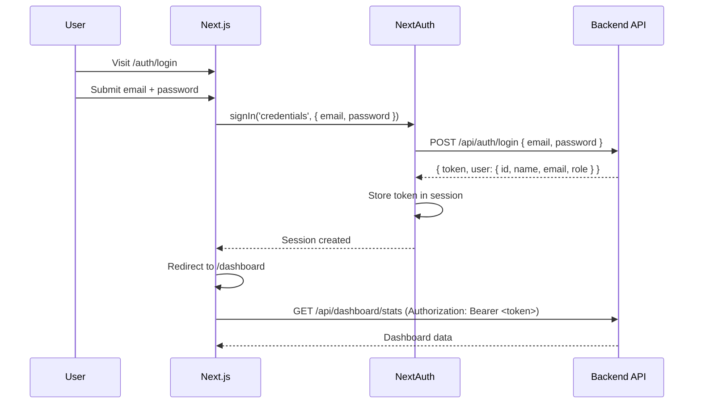

# HERMES — Frontend Documentation

## Overview

The frontend is a **Next.js 15** application using the App Router and React 19. It serves as the management dashboard for the HERMES AI outreach platform. Location: `apps/frontend/src`.

---

## Folder Structure

```
apps/frontend/src/
├── app/
│   ├── layout.tsx                    # Root HTML layout (fonts, metadata)
│   ├── page.tsx                      # Root redirect → /dashboard
│   ├── globals.css                   # Tailwind base + custom CSS variables
│   ├── providers.tsx                 # Client providers wrapper
│   ├── not-found.tsx                 # 404 page
│   ├── middleware.ts                 # Auth guard (session check)
│   ├── api/
│   │   └── auth/[...nextauth]/
│   │       └── route.ts              # NextAuth catch-all API handler
│   ├── auth/
│   │   └── login/
│   │       └── page.tsx              # /auth/login
│   └── (dashboard)/                  # Route group — protected pages
│       ├── layout.tsx                # Dashboard shell (Sidebar + Header)
│       ├── dashboard/page.tsx        # /dashboard
│       ├── prospects/page.tsx        # /prospects
│       ├── companies/page.tsx        # /companies
│       ├── contacts/page.tsx         # /contacts
│       ├── research/page.tsx         # /research
│       ├── emails/page.tsx           # /emails
│       ├── approvals/page.tsx        # /approvals
│       ├── settings/page.tsx         # /settings (ADMIN only)
│       └── waitlist/page.tsx         # /waitlist
├── components/
│   ├── layout/
│   │   ├── Header.tsx                # Top navigation bar
│   │   └── Sidebar.tsx               # Left navigation
│   ├── auth/
│   │   └── LoginForm.tsx             # Email + password form
│   ├── dashboard/
│   │   ├── DashboardStats.tsx        # KPI cards
│   │   ├── RecentActivity.tsx        # Activity feed list
│   │   └── ConversionChart.tsx       # Recharts funnel/bar chart
│   ├── prospects/
│   │   └── ProspectList.tsx          # Paginated prospect table
│   ├── companies/                    # Company management components
│   ├── contacts/
│   │   └── ContactsList.tsx          # Contact table
│   ├── emails/
│   │   └── EmailList.tsx             # Email list with action buttons
│   ├── approvals/
│   │   └── ApprovalQueue.tsx         # Approval workflow UI
│   ├── discovery/
│   │   └── DiscoveryPanel.tsx        # Prospect discovery form + results
│   └── settings/
│       └── SettingsPanel.tsx         # Integration settings form
├── lib/
│   ├── auth.ts                       # NextAuth config + Credentials provider
│   ├── api.ts                        # Axios instance + token interceptor
│   └── utils.ts                      # cn(), formatDate(), etc.
└── store/
    └── app.store.ts                  # Zustand global UI state
```

---

## Routing

### Public Routes
- `/auth/login` — Login page (no session required)

### Protected Routes (route group `(dashboard)`)
All routes under `(dashboard)/` require an active NextAuth session. The `middleware.ts` redirects unauthenticated users to `/auth/login`.

| Route | Component | Purpose |
|---|---|---|
| `/dashboard` | `DashboardStats` + `ConversionChart` + `RecentActivity` | Pipeline KPIs and activity |
| `/prospects` | `ProspectList` | Browse and manage prospect companies |
| `/companies` | Companies page | Detailed company management |
| `/contacts` | `ContactsList` | Decision-maker contact management |
| `/research` | Research page | View AI research results per company |
| `/emails` | `EmailList` | Browse generated emails, send approved ones |
| `/approvals` | `ApprovalQueue` | Email approval workflow |
| `/settings` | `SettingsPanel` | Integration credentials (ADMIN only) |
| `/waitlist` | Waitlist page | Waitlist capture and email dispatch |

---

## Authentication Flow



### Key Files

**`lib/auth.ts`** — NextAuth v5 configuration:
```typescript
export const { handlers, auth, signIn, signOut } = NextAuth({
  providers: [
    Credentials({
      authorize: async (credentials) => {
        const res = await fetch(`${env.NEXTAUTH_URL}/api/auth/login`, {
          method: 'POST',
          body: JSON.stringify(credentials)
        })
        const data = await res.json()
        if (data.success) return { ...data.data.user, token: data.data.token }
        return null
      }
    })
  ],
  callbacks: {
    jwt: ({ token, user }) => { if (user) token.accessToken = user.token; return token },
    session: ({ session, token }) => { session.accessToken = token.accessToken; return session }
  }
})
```

**`lib/api.ts`** — Axios instance with JWT injection:
```typescript
const api = axios.create({ baseURL: process.env.NEXT_PUBLIC_API_URL })

api.interceptors.request.use(async (config) => {
  const session = await getSession()
  if (session?.accessToken) {
    config.headers.Authorization = `Bearer ${session.accessToken}`
  }
  return config
})

api.interceptors.response.use(
  (response) => response,
  (error) => {
    if (error.response?.status === 401) signOut({ redirectTo: '/auth/login' })
    return Promise.reject(error)
  }
)
```

**`app/middleware.ts`**:
```typescript
export { auth as middleware } from '@/lib/auth'
export const config = {
  matcher: ['/((?!api|_next/static|_next/image|favicon.ico|auth).*)']
}
```

---

## State Management

### React Query (`@tanstack/react-query`)
Used for all server data. Configured in `providers.tsx` with:
- `staleTime: 30_000` (30 seconds)
- `gcTime: 300_000` (5 minutes)
- Auto-refetch on window focus

```typescript
// Example usage in a component
const { data, isLoading, refetch } = useQuery({
  queryKey: ['prospects', filters],
  queryFn: () => api.get('/api/prospects', { params: filters }).then(r => r.data)
})
```

### Zustand (`store/app.store.ts`)
Lightweight store for UI-only state that doesn't need server synchronization:
- `sidebarOpen: boolean` — sidebar collapse state
- `selectedProspect: string | null` — currently viewed prospect ID
- Notification/toast state

### NextAuth Session
Authentication state is managed entirely by NextAuth. Components access the session via `useSession()` hook.

---

## Components

### Layout Components

**`Header.tsx`**
- Displays: App name, user avatar, user email, logout button
- Uses `useSession()` for user info
- Calls `signOut()` on logout click

**`Sidebar.tsx`**
- Navigation links to all dashboard routes
- Active state via `usePathname()`
- Links: Dashboard, Prospects, Companies, Contacts, Research, Emails, Approvals, Settings, Waitlist
- Collapse toggle (Zustand state)

### Dashboard Components

**`DashboardStats.tsx`**
- Fetches from `GET /api/dashboard/stats`
- Displays KPI cards: Total Prospects, Emails Generated, Emails Approved, Emails Sent, Reply Rate, Conversions
- Uses `recharts` `ResponsiveContainer` + `BarChart` or `StatCard` components

**`ConversionChart.tsx`**
- Recharts bar/funnel chart showing pipeline stage counts
- Data: NEW → RESEARCHED → EMAIL_PENDING → EMAIL_SENT → REPLIED → CONVERTED

**`RecentActivity.tsx`**
- Fetches from `GET /api/dashboard/activity`
- Scrollable list of recent Activity records with timestamp, type, and entity info

### Prospect Components

**`ProspectList.tsx`**
- Table with columns: Company Name, Industry, Country, Status, Created At, Actions
- Pagination controls
- Status badge (color-coded by ProspectStatus)
- Action buttons: View Details, Trigger Research, Trigger Email
- Filter dropdowns: Status, Industry, Country

### Contact Components

**`ContactsList.tsx`**
- Table with columns: Name, Title/Role, Email, Phone, LinkedIn, Company, Verified
- Inline email verification status badge
- Add/edit/delete actions

### Email Components

**`EmailList.tsx`**
- Table with columns: Subject, Company, Contact, Status, Score, Created At, Actions
- Action buttons: View, Approve, Skip, Send, Regenerate
- Status badge (color-coded by EmailStatus)
- Review score displayed as percentage

### Approval Components

**`ApprovalQueue.tsx`**
- Shows all `PENDING_APPROVAL` emails
- Each item: Company name, contact, email preview (truncated), review scores, approve/skip/revise buttons
- Approve → calls `POST /api/approvals/:emailId/approve`
- Revise → opens modal with instruction input → calls `POST /api/approvals/:emailId/revise`

### Discovery Components

**`DiscoveryPanel.tsx`**
- Form fields: Industry, Country, Keywords, Limit (number)
- Submit → `POST /api/discovery/search`
- Results displayed as company cards with import checkbox
- Import button → `POST /api/discovery/import` with selected companies

### Settings Components

**`SettingsPanel.tsx`**
- Tabbed UI: AI Settings, Email Settings, Integration Keys
- Each tab: form inputs for the relevant env-backed settings
- Save → `PUT /api/settings`
- Test Connection button per integration → `POST /api/settings/test/:integration`

---

## Forms

All forms use **React Hook Form** with **Zod resolvers**:

```typescript
const form = useForm<LoginSchema>({
  resolver: zodResolver(loginSchema),
  defaultValues: { email: '', password: '' }
})
```

Validation errors are displayed inline below each field. Submit states use `form.formState.isSubmitting` to show loading indicators.

---

## API Layer (`lib/api.ts`)

Single Axios instance pre-configured with:
- `baseURL: process.env.NEXT_PUBLIC_API_URL`
- Request interceptor: injects `Authorization: Bearer <token>` from session
- Response interceptor: redirects to `/auth/login` on 401

---

## Theme & Styling

- **Tailwind CSS** with PostCSS pipeline
- **Custom CSS variables** in `globals.css` for dark/light mode tokens
- **Component variants** using `clsx` + `tailwind-merge` (`cn()` utility in `lib/utils.ts`)
- **Lucide React** for all icons
- **Sonner** for toast notifications (top-right corner, auto-dismiss)
- **Recharts** for data visualization

---

## Performance Optimizations

| Optimization | Implementation |
|---|---|
| Static assets cached 1 year | Nginx: `/_next/static/*` → `Cache-Control: public, max-age=31536000, immutable` |
| React Query stale-while-revalidate | 30s stale time, background revalidation on window focus |
| Next.js Image optimization | `next/image` for all images (automatic WebP conversion, lazy load) |
| Route-level code splitting | App Router automatic per-page bundle splitting |
| Server Components | Layout components rendered server-side where no client state needed |
| Gzip compression | Nginx gzip for HTML, CSS, JS, JSON responses |
| PM2 memory limit | 768MB restart threshold prevents memory leak accumulation |

---

## Rendering Lifecycle

1. Nginx receives request, routes to Next.js `:3000`
2. `middleware.ts` checks session → redirect to `/auth/login` if missing
3. Route matched in App Router
4. Server Component (layout/page) renders on server
5. HTML streamed to browser
6. React 19 hydration runs on client
7. Client components mount, React Query initializes
8. Data fetching hooks fire, loading states displayed
9. API responses arrive, UI updates

---

## Error Handling

- **API errors**: Caught in React Query `onError` callbacks → Sonner toast
- **Form errors**: Zod validation inline under fields
- **401 Unauthorized**: Axios interceptor → automatic redirect to login
- **Not Found**: `not-found.tsx` rendered for unmatched routes
- **Network errors**: React Query retry (3 times) with exponential backoff
