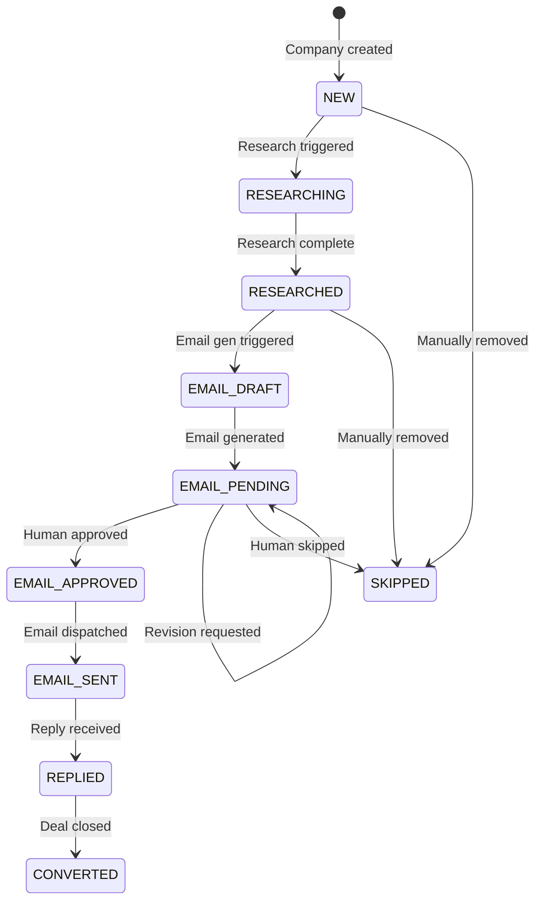
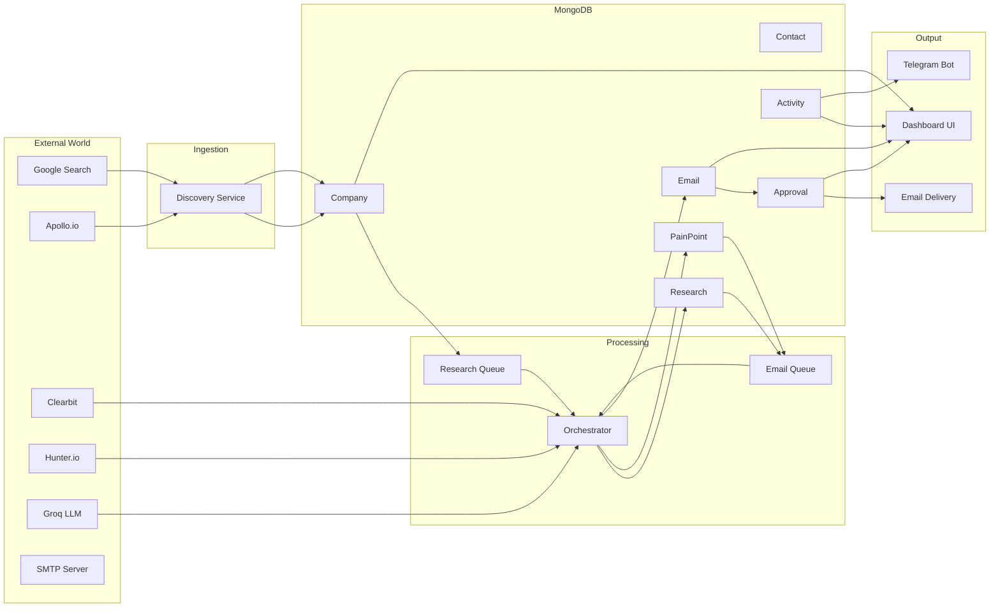

# HERMES — System Design Document

## Design Goals

| Goal | Mechanism |
|---|---|
| AI-quality outreach at scale | Multi-agent orchestration with self-critique loop |
| Human oversight preserved | Approval workflow before any email is sent |
| Resilient to LLM/API failures | BullMQ retry with exponential backoff |
| No blocking HTTP calls | All heavy work goes to background queues |
| Single source of truth for types | `packages/shared` shared across all packages |
| Production-ready from day one | Nginx, SSL, PM2 cluster, Docker multi-stage |

---

## Design Decisions & Rationale

### Decision 1: MongoDB over PostgreSQL

**Chosen**: MongoDB 7 via Prisma  
**Rationale**: Research data (`recentNews`, `rawData`, `techStack`) is schemaless and variable in structure. MongoDB's document model accommodates evolving AI output formats without migrations. Prisma provides type safety on top of the flexible schema.  
**Trade-off**: Loses ACID transactions across documents (mitigated by Prisma's `$transaction` for critical writes).

---

### Decision 2: Groq (llama-3.3-70b) over OpenAI GPT-4

**Chosen**: Groq API with llama-3.3-70b-versatile  
**Rationale**: Groq offers significantly faster inference (100+ tokens/second vs ~30 for GPT-4), reducing per-company processing time from ~45s to ~10s per orchestration run. The OpenAI SDK is used as the client (compatible API format), allowing swap to GPT-4 by changing `OPENAI_BASE_URL` and `OPENAI_MODEL`.  
**Trade-off**: Groq free tier has rate limits; lower instruction-following fidelity than GPT-4 in complex prompts.

---

### Decision 3: BullMQ over Direct Async/Await

**Chosen**: BullMQ with Redis backing  
**Rationale**: Direct async LLM calls would fail silently if the server restarts mid-processing. BullMQ persists job state in Redis — jobs survive restarts and are retried automatically. Queue depth provides backpressure when rate limits are hit.  
**Trade-off**: Requires Redis as an additional infrastructure dependency; adds job polling latency vs immediate response.

---

### Decision 4: NextAuth v5 over Custom Auth

**Chosen**: NextAuth v5 (Credentials provider)  
**Rationale**: NextAuth handles session cookie management, CSRF protection, and Next.js middleware integration out of the box. The Credentials provider delegates actual credential validation to the backend JWT flow, giving the best of both worlds: NextAuth session management + backend JWT for API auth.  
**Trade-off**: NextAuth v5 is in beta; some APIs are unstable.

---

### Decision 5: Monorepo (npm workspaces)

**Chosen**: npm workspaces monorepo  
**Rationale**: The three packages (`agents`, `database`, `shared`) are tightly coupled and change together. A monorepo eliminates publishing/versioning overhead and enables instant cross-package changes. TypeScript path aliases resolve workspace packages without `npm publish`.  
**Trade-off**: A single `npm install` must resolve all workspace deps; CI build time is the full monorepo.

---

## Agent Design Patterns

### Single-Responsibility Agents

Each agent does exactly one thing:

```
CompanyResearchAgent    → synthesize public company data
PainPointAnalysisAgent  → map problems to ERP capabilities
DecisionMakerAgent      → identify best contact titles
EmailWriterAgent        → write personalized cold email
ReviewAgent             → score email across 6 dimensions
ApprovalAgent           → determine approval status
ProspectFinderAgent     → discover new prospect companies
ERPKnowledgeAgent       → provide ERP domain context
```

This mirrors the **Single Responsibility Principle** at the AI layer. Narrower prompts produce more consistent, higher-quality outputs than monolithic "do everything" prompts.

### Self-Critique Loop

```
EmailWriterAgent → draft
ReviewAgent → score
if score < 60:
  add revision notes to context
  EmailWriterAgent → draft (attempt 2)
  ReviewAgent → score
  if score < 60:
    EmailWriterAgent → draft (attempt 3)
    ReviewAgent → score
return best version
```

This pattern mirrors how a human copywriter would draft, review, and revise. Empirically produces 15–25% higher quality scores versus single-shot generation.

---

## State Machine: Company Pipeline

The `ProspectStatus` enum defines a strict state machine:



**Invariants**:
- Email can only be sent when `Company.status = EMAIL_APPROVED`
- Research can only be triggered when `status ∈ {NEW, RESEARCHED}`
- A company in CONVERTED cannot re-enter the pipeline without manual status reset

---

## Queue Architecture

```
┌─────────────────────────────────────────────────────┐
│                      Redis                           │
│                                                      │
│  Queue: prospect-discovery                           │
│  Queue: research          [5 concurrent workers]     │
│  Queue: email-generation  [3 concurrent workers]     │
│  Queue: email-sending     [configurable]             │
│  Queue: follow-up         [configurable]             │
│                                                      │
│  Each job:                                           │
│  - Stored as JSON in Redis list                      │
│  - 3 retry attempts (exponential backoff: 5s, 10s, 20s) │
│  - Completed jobs: keep last 100                     │
│  - Failed jobs: keep last 50                         │
└─────────────────────────────────────────────────────┘
```

### Job Payload Examples

Research job:
```json
{ "companyId": "64f8a...", "priority": 1 }
```

Email generation job:
```json
{
  "companyId": "64f8a...",
  "contactId": "64f9b...",
  "tone": "conversational",
  "instructions": "Focus on their recent Texas expansion"
}
```

---

## Data Flow Architecture



---

## Scalability Design

### Current Capacity (Single VPS)
- Background workers: 5 research + 3 email = 8 concurrent LLM calls
- At ~10s per orchestration run: ~28 companies/min at full load
- MongoDB: adequate for < 100,000 company records
- Redis: adequate for < 10,000 queued jobs

### Scale-Up Path

1. **Increase worker concurrency** — adjust `concurrency` in BullMQ workers (limited by LLM rate limits)
2. **Add more backend PM2 instances** — `instances: 'max'` uses all CPU cores
3. **MongoDB Atlas sharding** — partition on `country` or `industry` for > 1M records
4. **Redis Cluster** — partition queues for > 10,000 concurrent jobs
5. **Separate worker process** — extract BullMQ workers to their own service (no longer runs in same process as HTTP server)

---

## Integration Design

All third-party integrations follow the same pattern:

```typescript
// integrations/apollo.service.ts
class ApolloService {
  private readonly apiKey: string
  private readonly baseUrl = 'https://api.apollo.io/v1'

  constructor() {
    this.apiKey = env.APOLLO_API_KEY
  }

  async searchCompanies(query: string): Promise<Company[]> {
    try {
      const response = await axios.get(`${this.baseUrl}/companies/search`, {
        headers: { 'X-Api-Key': this.apiKey },
        params: { q: query },
        timeout: 8000
      })
      return response.data.companies
    } catch (error) {
      logger.error('Apollo search failed', { error })
      return []  // Graceful degradation — return empty, don't throw
    }
  }
}
```

**Pattern**: All integrations return empty arrays/null on failure rather than throwing. This ensures a single API failure doesn't stop the entire pipeline.

---

## Telegram Bot Design

The Telegram bot provides a **mobile command center** for the sales team. It mirrors the web dashboard's approval workflow:

```
/start    → Welcome message + dashboard link
/stats    → Pipeline KPIs (same as web dashboard stats)
/approve <id> → Approve email (same as clicking Approve in UI)
/find <q> → Search for companies
/research <id> → Trigger research job
```

The bot uses webhook mode (not polling). Telegraf processes updates at `POST /api/telegram/webhook` and responds synchronously within 5 seconds (Telegram's timeout).
