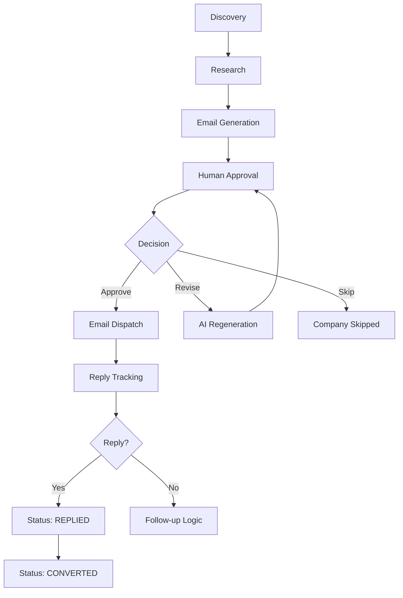
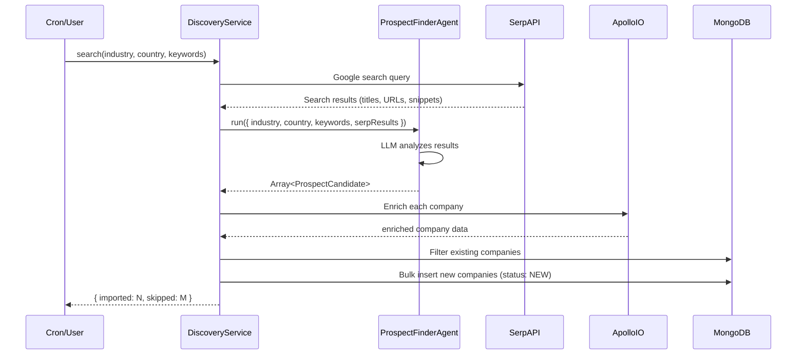
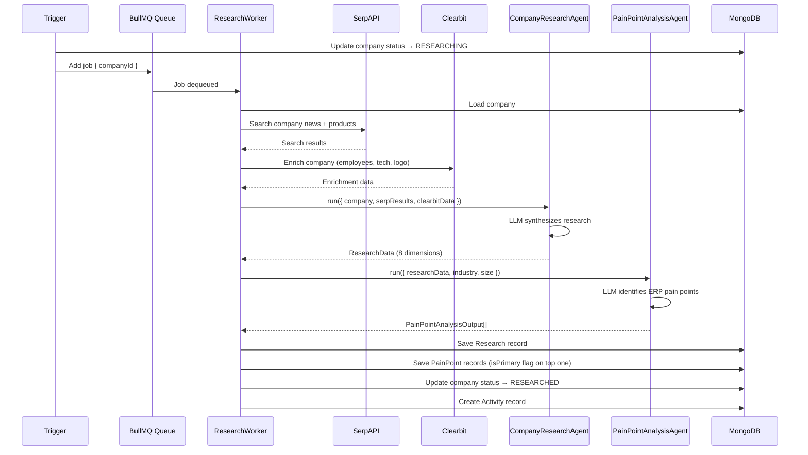

# HERMES — Complete Workflow Documentation

## Application Startup Workflow

```
1. Node.js process starts (index.ts)
   ├── Zod validates all env variables
   │   └── Process exits if any required var missing
   ├── Winston logger initializes (console + file transports)
   ├── ioredis client connects to Redis
   │   └── Retry: exponential backoff, max 10 attempts
   ├── Prisma client initializes MongoDB connection
   ├── BullMQ queues initialized:
   │   ├── research
   │   ├── email-generation
   │   ├── prospect-discovery
   │   ├── email-sending
   │   └── follow-up
   ├── Background workers started:
   │   ├── ResearchWorker (concurrency: 5)
   │   ├── EmailGenerationWorker (concurrency: 3)
   │   └── ProspectDiscoveryWorker (concurrency: 1)
   ├── Cron jobs registered (node-cron):
   │   ├── Daily 2am: Prospect discovery
   │   ├── Every 2h: Company research
   │   ├── Every 4h: Email generation
   │   └── Daily 1am: Stats aggregation
   ├── Telegram bot initializes (Telegraf)
   │   └── Registers webhook at TELEGRAM_WEBHOOK_URL
   └── Express app starts listening on PORT (4000)
       └── "HERMES API running on port 4000"
```

---

## Core Business Workflow: End-to-End Pipeline



---

## Phase 1: Prospect Discovery

### Trigger
- Automated: Cron job runs daily at 2am
- Manual: User submits discovery form (`POST /api/discovery/search`)

### Flow



---

## Phase 2: Company Research

### Trigger
- Automated: Research worker picks up NEW companies every 2 hours
- Manual: User clicks "Trigger Research" on prospect, or calls `POST /api/prospects/:id/research`

### Flow



### CompanyResearchAgent Output Structure

```json
{
  "products": ["Precision machined components", "Aerospace sub-assemblies"],
  "locations": ["Detroit, MI (HQ)", "Dallas, TX (Warehouse)"],
  "recentNews": [
    { "title": "Acme Wins Boeing Contract", "url": "...", "date": "2026-06", "summary": "..." }
  ],
  "expansionPlans": ["Expanding to Texas facility 2026 Q3"],
  "hiringActivity": ["Hiring 15 CNC operators", "Opening operations manager role"],
  "techStack": ["SAP (outdated)", "Excel-based scheduling"],
  "investments": ["$5M Series A 2025"],
  "acquisitions": [],
  "summary": "Mid-size precision manufacturer, rapid growth, struggling with legacy SAP...",
  "confidenceScore": 0.87
}
```

### PainPointAnalysisAgent Output Structure

```json
[
  {
    "problem": "Manual production scheduling in Excel causing delivery delays",
    "erpCapability": "Advanced Production Planning (APP)",
    "businessOutcome": "Reduce late deliveries by 35%, improve customer satisfaction",
    "evidenceScore": 0.92,
    "isPrimary": true
  },
  {
    "problem": "No real-time inventory visibility across 2 facilities",
    "erpCapability": "Multi-warehouse Inventory Management",
    "businessOutcome": "Eliminate stockouts, reduce safety stock by 20%",
    "evidenceScore": 0.78,
    "isPrimary": false
  }
]
```

---

## Phase 3: Email Generation (HermesOrchestrator)

### Trigger
- Automated: Email generation worker runs every 4 hours for RESEARCHED companies
- Manual: User clicks "Generate Email", calls `POST /api/prospects/:id/email`

### Full Orchestrator Flow

```mermaid
sequenceDiagram
    participant Worker
    participant HermesOrchestrator
    participant DecisionMakerAgent
    parameter HunterIO
    participant EmailWriterAgent
    participant ReviewAgent
    participant ApprovalAgent
    participant MongoDB

    Worker->>MongoDB: Load company + research + pain points
    Worker->>HunterIO: findEmail(firstName, lastName, domain)
    HunterIO-->>Worker: Verified email address
    Worker->>HermesOrchestrator: run(context)

    HermesOrchestrator->>DecisionMakerAgent: Identify best contact roles
    DecisionMakerAgent-->>HermesOrchestrator: { targetRoles, reasoning }

    loop Up to 3 attempts
        HermesOrchestrator->>EmailWriterAgent: run({ contact, company, research, painPoints, tone, previousVersions })
        EmailWriterAgent-->>HermesOrchestrator: GeneratedEmail { subject, body }

        HermesOrchestrator->>ReviewAgent: run({ email, companyContext, contactContext })
        ReviewAgent-->>HermesOrchestrator: ReviewOutput { scores, passed, revisions }

        alt Score >= 60 (passed)
            HermesOrchestrator->>ApprovalAgent: run({ email, review, autoApprove })
            ApprovalAgent-->>HermesOrchestrator: ApprovalOutput { status, reason }
            Note over HermesOrchestrator: Exit loop
        else Score < 60 (failed)
            Note over HermesOrchestrator: Store version, increment attempt, retry with revision notes
        end
    end

    HermesOrchestrator-->>Worker: OrchestrationResult { email, approvalStatus, attempts, tokensUsed }
    Worker->>MongoDB: Save Email record (status: PENDING_APPROVAL)
    Worker->>MongoDB: Update company status → EMAIL_PENDING
    Worker->>MongoDB: Create Activity record
```

### Email Review Scoring Dimensions

| Dimension | Weight | What It Measures |
|---|---|---|
| `researchRelevance` | High | Are specific company facts from research used? |
| `personalization` | High | Does the email address the individual contact's role? |
| `humanTone` | Medium | Does it read naturally? No AI-speak or buzzwords? |
| `businessValue` | High | Is the value proposition clear and specific? |
| `replyProbability` | Medium | Is there a clear, low-friction CTA? |
| `overall` | — | Composite score (weighted average) |

**Minimum passing score**: 60/100 overall. If all 3 attempts fail, the best-scoring version is used.

### Email Writer Tone Options

| Tone | Style |
|---|---|
| `formal` | Professional, structured, appropriate for C-suite |
| `conversational` | Friendly, direct, like a peer-to-peer message |
| `challenger` | Provocative, challenges status quo, questions current approach |

---

## Phase 4: Human Approval

### Via Web Dashboard

```
1. User navigates to /approvals
2. ApprovalQueue component loads PENDING_APPROVAL emails
3. User reads email subject, body preview, review scores
4. User chooses:
   - APPROVE: Email.status → APPROVED, ready to send
   - SKIP: Email.status → SKIPPED, Company.status → SKIPPED
   - REVISE: Opens revision modal, user types instructions
               → Triggers regeneration job with instructions
               → Email.status back to DRAFT until regenerated
```

### Via Telegram Bot

```
/approve <emailId>  → Approve the email
/stats              → View pipeline statistics
/find <company>     → Search for a company
/research <id>      → Trigger research for a company
```

---

## Phase 5: Email Dispatch

### Trigger
User clicks "Send" on an APPROVED email, or calls `POST /api/emails/:id/send`

### Flow

```
1. Load Email record (must be status: APPROVED)
2. Load Contact record (for To: address)
3. Nodemailer creates SMTP transport from env config
4. Send email:
   - From: SMTP_FROM
   - To: contact.email
   - Subject: email.subject
   - HTML/Text: email.body
5. On success:
   - Email.status → SENT
   - Email.sentAt = now()
   - Email.messageId = SMTP messageId
   - Company.status → EMAIL_SENT
   - Create Activity record
6. On failure:
   - Log error
   - Email.bounced = true (if bounce)
   - Return error response
```

---

## Data Transformation Flow

```
Raw Google/Apollo Data
         ↓ (ProspectFinderAgent)
Structured ProspectCandidate objects
         ↓ (importCompanies)
Company records in MongoDB (status: NEW)
         ↓ (SerpAPI + Clearbit + CompanyResearchAgent)
Research record (8 structured dimensions)
         ↓ (PainPointAnalysisAgent)
PainPoint records (with evidenceScore, isPrimary)
         ↓ (HunterIO + HermesOrchestrator)
Email record (subject, body, reviewScores, version)
         ↓ (Human approval)
Email record (status: APPROVED)
         ↓ (Nodemailer SMTP)
Email delivered to prospect
         ↓ (reply tracking — manual update)
Company.status → REPLIED → CONVERTED
```

---

## Error Handling & Retry Workflow

### Queue Job Failures

```
Job attempt 1 fails
   ↓ Wait 5 seconds (exponential backoff base)
Job attempt 2 fails
   ↓ Wait 10 seconds
Job attempt 3 fails
   ↓ Job moved to FAILED state in Redis
   ↓ Error logged to Winston
   ↓ Company status NOT updated (remains in previous state)
```

### LLM Failures (Orchestrator)

```
Agent LLM call fails
   ↓ BaseAgent.wrap() catches error
   ↓ Returns AgentResult<T> { success: false, error: "..." }
   ↓ Orchestrator logs failure, increments attempt counter
   ↓ If max attempts reached: returns best available result
```

### API Integration Failures

- SerpAPI failure: Research continues without Google news data
- Clearbit failure: Research continues without enrichment data
- Hunter.io failure: Email generated without verified contact email
- Apollo.io failure: Discovery continues with AI-only results

---

## Cron Workflow Schedule

```
┌─────────────────────────────────────────────────────────────────┐
│ 1am  │ Stats aggregation (dashboard metrics recalculation)      │
│ 2am  │ Prospect discovery (search for new manufacturing companies)│
│ Every 2h │ Research batch (process NEW companies in queue)      │
│ Every 4h │ Email batch (process RESEARCHED companies in queue)  │
└─────────────────────────────────────────────────────────────────┘
```

---

## Waitlist Workflow (Secondary Feature)

```
1. External website / form submits POST /api/waitlist with email
2. WaitlistLead created (status: PENDING)
3. Admin views waitlist at /waitlist in dashboard
4. Admin clicks "Send Emails"
5. POST /api/waitlist/send triggered
6. For each PENDING lead:
   a. Render nofoal-waitlist.ts HTML template
   b. Send via Nodemailer SMTP
   c. Update status → SENT, emailSentAt = now()
7. Return { sent: N, failed: M }
```

---

## Graceful Shutdown Workflow

```
SIGTERM/SIGINT received
   ↓
Express server stops accepting new connections
   ↓
Active requests drain (timeout: 30s)
   ↓
BullMQ workers stop processing new jobs
   ↓
Active jobs finish or timeout
   ↓
Redis connections closed (closeQueues())
   ↓
Prisma MongoDB connection closed
   ↓
Process exits 0
```
